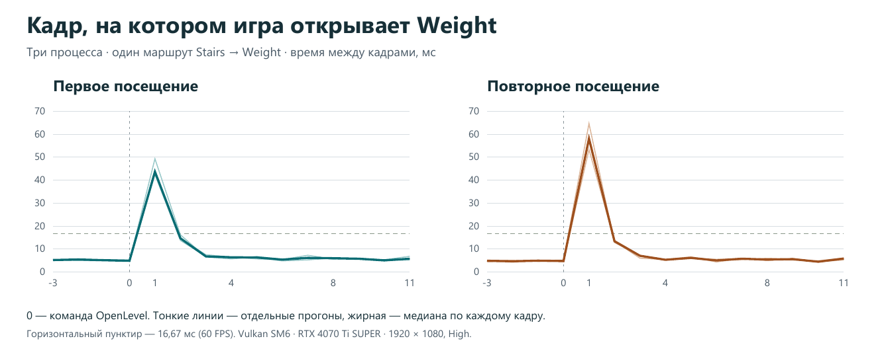

# A‑07. Время кадра, память и переходы на Vulkan

В упакованной кампании на RTX 4070 Ti SUPER p95/p99 времени кадра составили **6,28/7,54 мс**. При переходе Stairs → Weight отдельный кадр занял **42,46–64,65 мс** и превысил бюджет 16,67 мс для 60 FPS во всех шести наблюдениях. Максимальные значения за 12 запусков — **1957,52 МиБ резидентной RAM** и **2300,47 МиБ выделенной видеопамяти процесса**. [Сводка по каждому прогону](Measurements/A07-Vulkan.csv)

Приведённые ниже результаты относятся к пакету из PR #57. Для следующей ревизии отдельно измерены фазы загрузки Weight. [Разбор OpenLevel и проверка изменения](A07OpenLevel.md)

## Время кадра

В каждой паре указаны **p95 / p99, мс**. Каждое значение — медиана трёх независимых прогонов. В кампании измерено 8239, 8188 и 9354 кадра. На устойчивом виде Weight измерено по 300 кадров, на портале — по 1000 кадров в каждом запуске.

| Нагрузка | CPU | GPU | Время кадра |
| --- | ---: | ---: | ---: |
| Кампания от Stairs до пополнения кислорода на станции | 3,95 / 5,27 | 5,85 / 6,26 | 6,28 / 7,54 |
| Weight после первого перехода | 3,26 / 3,53 | 5,34 / 5,75 | 5,71 / 6,13 |
| Weight после повторного перехода | 2,98 / 3,17 | 5,54 / 5,86 | 5,73 / 6,15 |
| Вид на активный портал | 4,80 / 5,22 | 5,10 / 5,37 | 5,46 / 5,76 |
| Та же камера и портал с замороженным изображением | 3,03 / 3,30 | 4,65 / 4,89 | 5,01 / 5,29 |

**Стоимость обновления портала 960×540** по медиане трёх парных разностей составила **+0,44 / +0,48 мс GPU**, **+1,79 / +1,84 мс CPU** и **+0,44 / +0,49 мс ко времени кадра**. Основное различие на CPU видно в render thread — 4,80 / 5,22 мс при обновлении и 3,02 / 3,29 мс при остановленном захвате. Два отдельных контрольных снимка с кадра 900 подтвердили ту же позу, видимый проём и световую панель за ним в обоих режимах. Снимки сняты вне серии измерений. При ином угле обзора или наполнении связанной комнаты стоимость следует измерить заново.

## Первый и повторный переходы

| Независимый запуск | Первый LoadMap, мс | Повторный LoadMap, мс | Самый длинный кадр первого перехода, мс | Самый длинный кадр повторного перехода, мс |
| --- | ---: | ---: | ---: | ---: |
| 1 | 41,61 | 51,69 | 43,68 | 53,36 |
| 2 | 40,51 | 62,67 | 42,46 | 64,65 |
| 3 | 47,08 | 55,62 | 49,30 | 58,10 |
| Медиана | **41,61** | **55,62** | **43,68** | **58,10** |

Во всех трёх процессах повторный вход занял больше времени. Самый длинный кадр в каждом окне приходится на выполнение перехода, в CSV этот кадр помечен `GC`. Для определения доли сборки мусора, выгрузки и создания нового мира понадобится отдельная трассировка. График показывает фактические интервалы между кадрами. Граница окна анализа самого длинного кадра указана в методике ниже.



## Память

Максимум за весь жизненный цикл отдельного процесса, затем максимум трёх запусков каждого сценария. Оба общих пика наблюдались в кампании, в разных запусках. Медианный интервал опроса — 110 мс, наибольший — 285 мс.

| Сценарий | Пиковый working set, МиБ | Максимальный отсчёт выделенной VRAM, МиБ |
| --- | ---: | ---: |
| Полная кампания | 1957,52 | 2300,47 |
| Серия переходов | 1946,62 | 2179,02 |
| Активный портал | 1914,02 | 2167,22 |
| Замороженное изображение портала | 1935,98 | 2166,30 |

Эти результаты относятся к одной машине и текущему игровому контенту. Для A‑07 остаются RX 6800, RTX 3070 и Arc B580 с 16 ГБ системной памяти, затем проверка запуска и бюджета памяти на целевой минимальной конфигурации. Отдельный замер нужен для первого запуска после перезагрузки машины или очистки дисковых кэшей. [Целевые конфигурации](Rendering.md)


## Как измеряли

19 ноября 2026 г. Три независимых запуска каждого из четырёх сценариев. Windows 11 x64 10.0.26300.10066, Core i5-14400F (10 ядер / 16 потоков), 32 ГиБ RAM, RTX 4070 Ti SUPER (16 ГиБ), драйвер 621.24, план питания Windows «Высокая производительность». Частоты и температура GPU не фиксировались. Варианты портала чередовались парами active/frozen, frozen/active, active/frozen.

- Один упакованный `Win64 Development` из UE 5.7.4 с исправлением `PartialDepth`, SHA-256 игрового exe `E1E3E63015DC2E7E1AEED690A3D5CEE83BEF0806F68F9E68FE2F6E888F15B436`. Оконный Vulkan SM6, 1920×1080, High, TSR при внутреннем масштабе 100%, программный Lumen, VSync и ограничение FPS выключены. Время реальное, без `-benchmark`, фиксированного шага и записи видео. Каждый процесс получил новый каталог пользовательских данных.
- CPU — максимум `GameThreadTime`, `RenderThreadTime` и `RHIThreadTime` **для каждого кадра**. Параллельные потоки не складываются. Это длительность наиболее долгой из трёх измеренных полос CPU с возможными ожиданиями, а не счётчик полезных инструкций. GPU — `GPUTime` UE от аппаратных временных меток RHI. В `LaunchEngineLoop.cpp` UE 5.7.4 переводит циклы всех четырёх счётчиков в миллисекунды через `FPlatformTime::ToMilliseconds`. GPU возвращает последнее готовое измерение с задержкой. `FrameTime` — фактический интервал движка между кадрами, включая паузы.
- p95 и p99 рассчитаны методом ближайшего ранга отдельно в каждом запуске (позиция `ceil(p × N)`, начиная с 1). В сводке приведена медиана трёх p95 и трёх p99. Общая длительность кадра вычислена из своего ряда, отдельно от CPU и GPU.
- RAM — максимум системного `PeakWorkingSet64` игрового процесса. VRAM — наибольший отсчёт WDDM `GPU Process Memory / Dedicated Usage` по PID этого же процесса. Весь интервал наблюдения включает старт, игровые миры и завершение. Это резидентная RAM и учтённая выделенная видеопамять процесса, а не память всей системы. Опрос с ожиданием 100 мс может пропустить краткий всплеск VRAM.
- **Кампания.** Штатная стартовая карта, `-VerifyEntryCourse`, Stairs → Button → Weight → Balance → переход «Авангарда» → станция. После восстановления кислорода процесс дописывает CSV и штатно выходит. В выборку входят все кадры начиная со 121-го, включая переходы между камерами. Старт загрузчика и первые 120 кадров исключены из квантилей.
- **Переход.** В свежем процессе открывается Stairs. На кадрах CSV 500, 1050 и 1600 запланированы переходы в Weight, Stairs и снова Weight. Сравниваются два одинаковых перехода Stairs → Weight. «Холодный» означает первый вход в этот сегмент **в данном процессе**, «тёплый» — повторный. Обе комнаты используют одну физическую карту `/Engine/Maps/Entry`. ОС, файловый кэш и кэш драйвера между запусками не сбрасывались. Длительность `LoadMap` взята из журнала UE, самый длинный кадр — из 12 отсчётов начиная с команды. Стабильный вид комнаты сравнивался на 300 кадрах от маркера +120 до +419.
- **Портал.** Проверка портальной комнаты подаёт питание, ставит игрока в фиксированную позу в 320 см от входа, подтверждает видимость окна и читает тёплый центральный пиксель связанной комнаты. Затем игрок и камера остаются на месте. В active продолжается захват 960×540. В frozen после проверки первого изображения отключается видимость только компонента захвата без распространения на окно. Окно показывает тот же render target, освещение, проём, питание и симуляция остаются активны. Измеряются последние 1000 из 1800 кадров с запасом не менее 120 кадров после маркера готовности. Разность квантилей считается внутри пары, затем берётся медиана трёх разностей.

## Повторение

Соберите Development-пакет этой ревизии. На машине Windows нужны PowerShell 7 и счётчик WDDM `GPU Process Memory`. Для обработки CSV подходит Python 3 из комплекта UE. Команды запускаются из корня проекта. [Сборка и упаковка](Testing.md#упакованная-игра-win64-development)

```powershell
$package = 'Saved/A07MeasuredPackage/Windows'
$runs = foreach ($round in 1..3) {
    $pair = if ($round -eq 2) { 'PortalFrozen', 'PortalActive' } else { 'PortalActive', 'PortalFrozen' }
    foreach ($scenario in @('Travel') + $pair + @('Campaign')) {
        ./Scripts/Measure-VulkanPackage.ps1 -PackageRoot $package -Scenario $scenario
    }
}
python Scripts/Summarize-VulkanProfile.py @runs
```

Для каждого запуска сохраняются исходные CSV UE, `Memory.csv`, `Game.log` и `Run.json` в отдельном каталоге `Saved/Performance`. В выводе обработчика пары значений идут в порядке p95, p99. Скрипт проверяет профиль рендера, число кадров, маркеры и наличие измерений Windows. Исходные журналы содержат локальные пути и идентификаторы среды.
