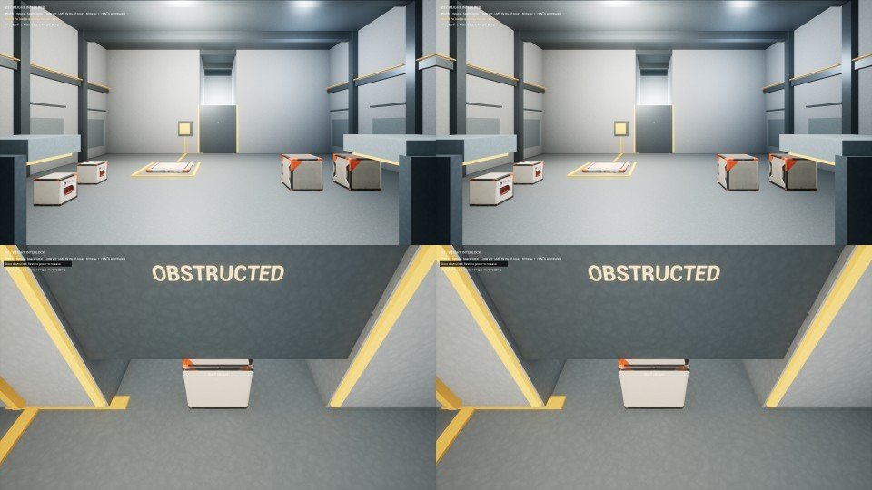

# A‑07. Инстансинг 11 видимых блоков Weight

**Решение для среза.** Инстансинг уменьшил p95 работы с геометрией на 0,498 мс с учётом регистрации групп. За 60 повторов p95 всего кадра снизился с 17,320 до 16,825 мс. В бюджет 16,67 мс уложились 55/60 входов у B и 52/60 у A. По отдельным процессам B выиграл две пары из четырёх. p95 полного GC при входе вырос на 0,103 мс, а самый медленный первый вход B занял 20,064 мс. Оставляем группировку доступной по флагу для составной оболочки. Этой серии достаточно для решения по 11 блокам.

## Кадр перехода и восстановление

По 60 повторных входов на вариант. Единица — миллисекунды, p95 по ближайшему верхнему рангу (57-е значение). Для p99 при N=60 берётся максимум. Кадр перехода — самый длинный из 12 кадров от команды OpenLevel. Окна следующих кадров отсчитаны от фактического кадра загрузки с маркером GC.

| Метрика | A · отдельные компоненты | B · инстансы | B − A |
| --- | ---: | ---: | ---: |
| Первый вход, медиана четырёх процессов | 17,306 | 17,242 | -0,065 |
| Кадр перехода, p95 | 17,320 | 16,825 | -0,495 |
| Кадр перехода, p99 | 18,349 | 17,326 | -1,023 |
| LoadMap, p95 | 15,376 | 14,845 | -0,531 |
| Инициализация акторов, p95 | 2,998 | 3,050 | 0,052 |
| Цикл 11 блоков, p95 | 0,630 | 0,003 | -0,627 |
| Регистрация всех групп, p95 | 0,215 | 0,388 | 0,173 |
| Оба цикла блоков и регистрация групп вместе, p95 | 0,895 | 0,397 | -0,498 |
| Физическое состояние составного тела, p95 | 0,116 | 0,134 | 0,018 |
| Первый тик мира, p95 | 1,158 | 1,125 | -0,033 |
| Следующий кадр, p95 | 13,222 | 12,729 | -0,493 |
| Худший кадр из 12 следующих, p95 | 13,222 | 12,729 | -0,493 |
| Худший кадр из 120 следующих, p95 | 13,222 | 12,729 | -0,493 |
| Внутренний p95 следующих 120 кадров, p95 по входам | 5,996 | 6,064 | 0,068 |
| Абсолютный максимум следующих 120 кадров | 14,372 | 13,492 | -0,880 |

Число попаданий в 16,67 мс — 52/60 → 55/60.

| Пара процессов | Первый вход A / B, мс | p95 повторов A / B, мс | В бюджете A / B, из 15 |
| --- | ---: | ---: | ---: |
| 1 | 17,108 / 17,118 | 16,673 / 16,907 | 14 / 14 |
| 2 | 17,174 / 20,064 | 18,349 / 16,934 | 12 / 14 |
| 3 | 17,439 / 17,047 | 16,978 / 17,326 | 12 / 13 |
| 4 | 18,324 / 17,366 | 17,679 / 16,681 | 14 / 14 |

## GC и память

| Фаза GC, p95 в мс | A | B | B − A |
| --- | ---: | ---: | ---: |
| Вход в Weight, полный GC | 7,975 | 8,078 | 0,103 |
| Проверка предположений | 0,579 | 0,528 | -0,051 |
| Достижимость | 0,570 | 0,694 | 0,124 |
| Отвязка недостижимых объектов | 0,358 | 0,590 | 0,232 |
| Purge | 3,428 | 3,256 | -0,172 |
| Отложенное завершение удаления | 2,756 | 2,583 | -0,172 |
| Возврат памяти | 3,268 | 3,108 | -0,160 |
| Возврат из Weight в Stairs, полный GC | 8,090 | 8,385 | 0,296 |

На повторных входах число освобождённых объектов A / B — 217, 225 / 217, 225. При возврате в Stairs — 190 / 181. Группировка меняет состав уходящего мира Weight.

| Пик за маршрут, МиБ | A | B | B − A |
| --- | ---: | ---: | ---: |
| Рабочий набор процесса | 1962,527 | 1953,586 | -8,941 |
| Частная память процесса | 4154,805 | 4135,195 | -19,609 |
| Выделенная видеопамять WDDM по PID | 2181,008 | 2181,016 | 0,008 |

Для рабочей памяти взят PeakWorkingSet Windows, для частной памяти и VRAM — максимум периодических выборок процесса. В таблице максимум четырёх процессов каждого режима, включая запуск и выход. Точности выборки недостаточно для оценки небольших различий VRAM на отдельном кадре.

## Проверка игровой механики и изображения

В том же пакете вариант B прошёл EntryCourse, EntryCourseAlternate, EntryCheckpoint, DoorClamp, WorldLifetime, VulkanTravelControl и VulkanExitControl. DoorClamp дополнительно прошёл с отдельными компонентами в A. Проверены поверхности 11 блоков, свободное прохождение капсулы в проёме и край пола, решение 10 + 5 + 5 кг, захват и освобождение куба дверью, восстановление массы, сброс и прямой старт из контрольной точки Weight. Во всех восьми запусках код выхода 0. Проверки завершения кампании, смены мира и пустого мира прошли контроль предупреждений аллокатора Vulkan.

Сопоставлены два ракурса A и B в 1920 × 1080: стартовый вид камеры с одной точки (команда Shot на кадре CSV 360) и момент зажима куба дверью. В обоих видны пол и стены с отделкой, тени, контур панели и подсветка проёма. При зажиме видны куб и предупреждение. При выборке каждого восьмого пикселя по обеим осям средняя абсолютная разница RGB на канал составила 0,14 из 255 для общего вида и 0,32 для двери. Вывод о визуальном совпадении относится к этим двум ракурсам.



## Граница работ по A‑07

**Текущую серию микрооптимизаций Weight заканчиваем этим сравнением.** Отдельно запустили тот же пакет в штатном режиме геометрии (раздельная коллизия, инстансированный декор, предзагрузка и группировка оболочки выключены). Первый вход — 17,585 мс. На 15 повторах в бюджет уложились 11, p95 и p99 — 17,796 мс. При таком объёме обе оценки совпадают с максимумом. Этот отдельный контроль относится к фактически поставляемой геометрии. [Контроль штатного режима](Measurements/A07-WeightShellVisualDefault.csv)

Следующая работа по замечанию — **один приёмочный прогон штатного профиля на текущем ПК** с первым запуском после обычной перезагрузки Windows и тёплыми повторами. Зафиксировать p95/p99 и число переходов в бюджете, выгрузку и восстановление. Для поставляемого асинхронного пути проверить ранний выход, повторный запрос и безопасный запоздавший callback. В текущей реализации экспериментальный callback предзагрузки только отмечает готовность меша. Завершение игры и смена карты проверены. Ранний выход в точно воспроизводимый момент незавершённого запроса этим A/B не проверялся. [Владение запросом](../Source/Abandoned/Private/TrainingChamber/ChamberMeshLibrary.cpp)

По результату приёмки — одно решение по текущему срезу: закрыть при достижении бюджета и прохождении проверок либо зафиксировать конкретное отклонение и принять его на этот этап решением владельца. Если отклонение неприемлемо, оставить открытой именно эту причину. Единичный редкий кадр сам по себе не запускает новую серию A/B. Проверка минимума с 8 ГБ остаётся на бете, подтверждение рекомендованных видеокарт и 16 ГБ — отдельной аппаратной приёмкой по [графическому профилю](Rendering.md).

## Методика и повторение

Один Win64 Development, UE 5.7.4, Windows 11, Vulkan SM6, Core i5‑14400F, RTX 4070 Ti SUPER, 32 ГБ ОЗУ. 1920 × 1080, масштаб 100%, тени 2, Binned2, один профиль с выключенными для измерения VSync и лимитом FPS. В обоих вариантах включены инстансинг декора, составное тело с 11 простыми боксами и предзагрузка меша оболочки. В A к телу прикреплены 11 отдельных видимых компонентов. В B тот же меш и трансформы блоков добавлены в группы по материалам вместе с декором. У инстансов отключена коллизия. Четыре подвижных куба, панель и дверь используют обычный игровой путь.

Выполнить A1, B1, B2, A2, B3, A3, A4, B4. На каждый процесс 16 входов в Weight с новым каталогом пользователя. Первый вход процесса приведён отдельно. Кеш ОС между запусками сохранялся. SHA‑256 EXE — `4b029298768b6568f28ecba515d2147fd0fc0fe64cd4e8a082f6c0cf3184a493`.

```powershell
$common = @{ PackageRoot = $package; TraceTravel = $true; WeightVisits = 16; ChamberDecor = 'Instanced'; WeightShell = 'Compound'; PreloadWeightShell = $true }
./Scripts/Measure-VulkanPackage.ps1 @common                              # A
./Scripts/Measure-VulkanPackage.ps1 @common -InstanceWeightShellVisuals   # B
```

Сохранить возвращённые пути как A1.path, B1.path и т. д. Рядом положить одноимённые экспорты GameThread из Timing Insights в формате A1.events.csv с вложенными событиями всех длительностей на каждой загрузке. Анализатор сверяет 11 блоков и одно физическое тело, режим группировки по журналу, полный маршрут и один EXE. [Данные каждого посещения](Measurements/A07-WeightShellVisualVisits.csv) · [Пики каждого процесса](Measurements/A07-WeightShellVisualProcesses.csv)

```powershell
python Scripts/Summarize-WeightShell.py $captures Docs/Measurements --visuals
```
