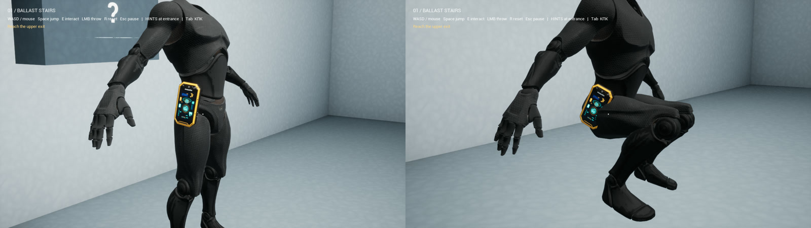
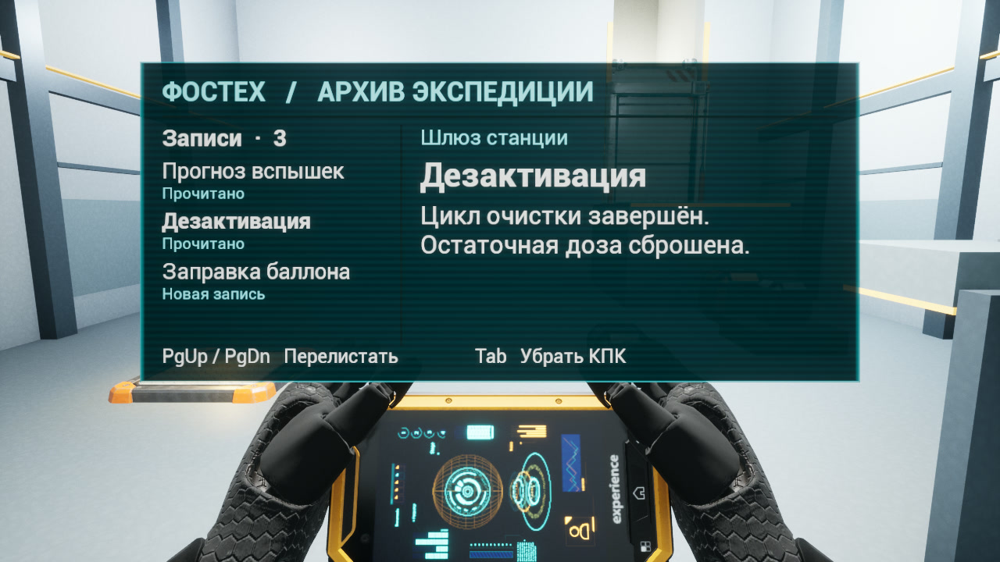

# Поясной Rugged Tablet 0.1 на Custom Manny V2

После слияния [PR #105](https://github.com/hhypest/abandoned/pull/105) на тот же скафандр установлен КПК из библиотеки владельца. Примерка доступна во входном контуре с параметром `-CustomMannyFit`. Для запуска нужны подготовленные локальные ассеты. [Rugged Tablet 0.1 от xiaofeiArt](https://www.fab.com/listings/fc879ff2-dbae-4e44-8920-5212b1b27e09) · [Титры и лицензия](../Content/Credits/RuggedTablet.txt)

## Крепление и хват

Корпус размером 24,0 × 13,6 × 3,3 см закреплён справа относительно кости `Hips`. На поясе длинная сторона идёт вдоль бедра. По Tab персонаж поднимает КПК и поворачивает его горизонтально. Пальцы используют вращения позы 45, а положение плеч, локтей и запястий рассчитывается по положению корпуса. Устройство можно убрать повторным Tab, в том числе во время доставания.



| Проверка в упакованной Stairs | Наблюдение |
|---|---|
| Стойка и глубокий присед | Корпус следует за тазом. Расхождение с сохранённым креплением в обеих позах и после возврата по Tab составило 0,000 см и 0,000° с точностью журнала. В приседе бедро частично закрывает нижнюю часть КПК с переднего ракурса. |
| Доставание и возврат | Ввод настоящих клавиш запускает движение. Световое поле появляется в конце подъёма. Повторный Tab, быстрое двойное нажатие и сброс R возвращают устройство на пояс и гасят поле. С балластом в руках Tab оставляет куб в хвате, а КПК на поясе. |
| Хват | В стойке и приседе точки на коже обеих ладоней пришлись на середины противоположных граней. Координаты в системе корпуса (см) — (0, +12, 0) и (0, −12, 0) при округлении до 0,01 см. Сверены ближайшие точки всех 770 треугольников LOD 0 импортированного FBX. Автоматический допуск на каждую ладонь — 1 мм. |
| Чтение | При 1280 × 720 проверены три записи из изолированного сохранения v2, смена записи в обе стороны и отметка прочтения. При 1920 × 1080 проверен пустой архив. Заголовок, источник, текст и подсказка управления видны целиком, кисти остаются ниже текста. |

[Вид вниз и момент доставания по Tab](Images/CustomManny-TabletDraw.jpg)



[Пустой архив в приседе, исходный кадр 1920 × 1080](Images/CustomManny-TabletEmpty.jpg)

Архив выводится в игровом мире над корпусом. PgUp и PgDn переключают запись. Открытые записи отмечены до завершения игровой сессии. Проверена вкладка архива. Вкладка «Система» и настройка размера шрифта остаются в [плане интерфейса](RetinalInterface.md).

## Воспроизведение

1. Подготовьте Custom Manny V2 и позу 45 по [инструкции для хвата куба](CubeGripFit.md#воспроизведение). Из архивов владельца положите файл `Rugged Tablet-fbx.fbx` в `AssetSource/RuggedTablet/`, а файлы `tablet_DefaultMaterial_*.png` в его подкаталог `textures/`.
2. Запустите импорт из корня проекта. Материал использует BaseColor, Normal, Roughness, Metallic и Emissive. Оригиналы и пакеты Fab хранятся локально.
3. Упакуйте три каталога примерки в Win64 Development и запустите проверку. Она создаёт новый каталог с отдельными сохранениями, журналами и кадрами для каждого разрешения.

```powershell
$ue = 'C:/Program Files/Epic Games/UE_5.7/Engine'
& "$ue/Binaries/Win64/UnrealEditor-Cmd.exe" "$pwd/Abandoned.uproject" "-ExecutePythonScript=$pwd/Scripts/PrepareRuggedTablet.py" -EnablePlugins=PythonScriptPlugin -unattended -vulkan -RenderOffscreen
$cook = 'CubeGrip', 'CustomMannyV2', 'RuggedTablet' | ForEach-Object { "-CookDir=$pwd/Content/AbandonedLocal/$_" }
& "$ue/Build/BatchFiles/RunUAT.bat" BuildCookRun "-project=$pwd/Abandoned.uproject" -noP4 -platform=Win64 -clientconfig=Development -build -cook "-AdditionalCookerOptions=$($cook -join ' ')" -stage -pak -package -archive "-archivedirectory=$pwd/Saved/TabletFit/Package" -unattended
& ./Scripts/Test-BeltTabletFit.ps1 -PackageRoot ./Saved/TabletFit/Package/Windows
```

Для просмотра вручную запустите `Abandoned.exe /Engine/Maps/Entry?Chamber=Stairs -CustomMannyFit -vulkan`. В Development команда консоли `InspectBeltTablet 1` показывает пояс сбоку, `InspectBeltTablet 0` возвращает камеру игрока.

Проверено 26 ноября 2026 г. на UE 5.7.4, Windows x64, Vulkan SM6 и RTX 4070 Ti SUPER. Шаг симуляции — 60 Гц. SHA-256 исполняемого файла — `3E92CBA26DF8DA8F3D4F8B9744B37ACBF39901DF5B062C6D69289674186BB787`. При выходе из Stairs Vulkan повторил известное предупреждение `Found 1 unfreed allocations!`. [Предыдущий прогон](CubeGripFit.md#хват-на-custom-manny-v2)
