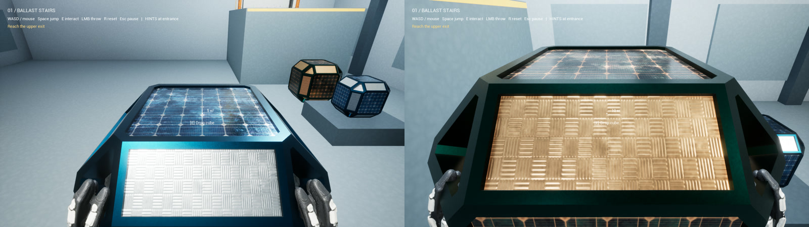
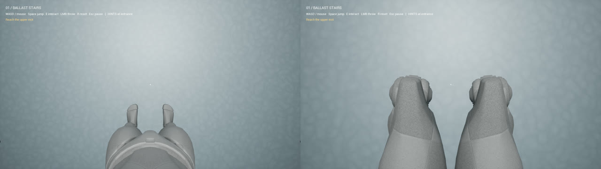
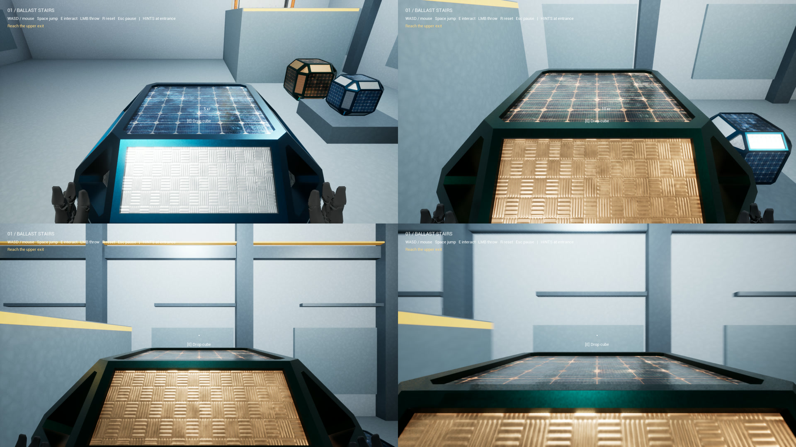

# Двуручный хват EQP-00 и Custom Manny V2

25 ноября 2026 г. в упакованной Win64 Development проверены два варианта в Stairs. Ключ `-FabCubeGrip` включает EQP-00 с позой 45 при переноске балласта. Ключ `-CustomMannyFit` показывает выбранный владельцем корпус Custom Manny V2 в камерах головоломок. Для сравнения их запускают по отдельности. Штатный маршрут доступен без ключей.

## Хват EQP-00 и взаимодействия

Пальцы обеих рук получили повороты 30 суставов из первого кадра позы 45. При подъёме физического куба руки тянутся к металлическим скосам по обе стороны ближайшей к игроку грани. Точки хвата привязаны к размерам куба. При отпускании руки возвращаются в исходную позу. [60 Finger Poses от Attaku](https://www.fab.com/listings/270419de-d3d7-4a7e-ae95-fc7781fe56ba)



| Проверка в игре | Наблюдение |
|---|---|
| Ладони, малый куб 55 см / 5 кг | Обе перчатки видны на скосах. Перед укладкой на плиту и перед сборкой стопки точки ладоней оставались в пределах скосов по 12 последовательных игровых тиков. |
| Ладони, большой куб 80 см / 10 кг | Обе точки удержались в пределах скосов все 12 тиков после подъёма нижнего куба. При наклоне камеры на 26° куб занимает большую часть поля зрения. |
| Укладка на плиту | Действие E поставило малый куб в положение подсказки. Плита приняла 5 кг и открыла дверь. |
| Стопка | Малый куб встал на большой. Суммарная масса составила 15 кг. Игрок поднялся по стопке. При подъёме нижнего куба верхний отделился. |
| Бросок и сброс | ЛКМ бросила куб вперёд. После броска и сброса оба запястья вернулись в исходное положение с допуском 1 мм. |

Контрольная точка ладони — середина между запястьем и основанием среднего пальца. Положение сравнивается с конечной площадкой скоса, измеренной по треугольникам видимого меша. В начале и конце каждой серии расстояние от точки внутри каждой перчатки до плоскости скоса составило 2,00 см. Это заложенная в примерку толщина ладони. Поверхность перчаток оценивали по игровым кадрам. Тест измеряет положение костей и допускает до 1 см дополнительного отклонения наружу.

## Выбранная модель

Из FBX `CustomPawn` импортирован корпус с собственным скелетом из 77 костей и четырьмя исходными картами 4096 × 4096. В Stairs при наклоне камеры на 89° стоя видны нижняя часть торса и ступни. В приседе большую часть фигуры в кадре занимают согнутые ноги. В этой примерке проверялось кадрирование. В PR #104 этот корпус проверялся стоя и в приседе. Результаты переноса хвата приведены ниже. [Custom Manny V2 от G4A Gaming Labs](https://www.fab.com/listings/ea644010-f0d1-4a39-bb01-75cf8cec1b1e)



## Хват на Custom Manny V2

В режиме `-CustomMannyFit` при подъёме балласта используется поза 45. Скрипт переносит 30 вращений пальцев из клипа Fab непосредственно в систему координат костей Custom Manny. Например, цепочка большого пальца начинается с `Thumb0`, а у указательного за `Index_01` следуют `IndexFinger2` и `IndexFinger3`. Положение ладони определяется по запястью и основанию среднего пальца. Обе кисти следуют за физическим кубом. Плечи подаются вперёд, локти остаются по бокам. Большой куб расположен на 10 см ниже исходного положения. Такая высота освобождает линию взгляда при ходьбе и сохраняет зазор между кубом и коллизией игрока.

Контакт проверяется по поверхности ладоней в движущемся скелете. Луч через середину ладони пересёк треугольники LOD 0 № 36654 слева и № 38831 справа на расстоянии 3,865 см от линии костей в пространстве меша. Все три вершины каждого треугольника полностью привязаны к своему запястью. Игровая проверка переводит эти две точки в систему координат физического куба, проверяет границы металлического скоса и измеряет зазор по нормали. Допуск составляет 5 мм внутрь и наружу. Каждая серия длится 12 последовательных игровых тиков после стабилизации груза.

| Проверка в Stairs | Результат на Custom Manny |
|---|---|
| Куб 55 см, 5 кг | В начале и конце двух серий расстояние от поверхности обеих ладоней до скосов округляется до 0,00 см. |
| Куб 80 см, 10 кг | После подъёма нижнего куба из стопки зазор слева 0,04 см, справа 0,10 см. Вся серия в допуске. |
| Обзор с 10 кг | При горизонтальной камере тёмный верхний край куба в центральной колонке кадра проходит примерно на 41 пиксель ниже прицела стоя и на 55 пикселей ниже при движении вперёд. Разрешение 1280 × 720. При взгляде вниз на 26° куб закрывает центр кадра. |
| Укладка, стопка и бросок | Плита приняла 5 кг, дверь открылась и закрылась после снятия груза. Стопка 15 кг выдержала подъём игрока. Верхний куб отделился при подъёме нижнего. ЛКМ бросила куб вперёд, после сброса оба запястья вернулись в исходное положение. |

В Win64 Development на UE 5.7.4 и RTX 4070 Ti SUPER прошли три сценария Vulkan SM6 с шагом 60 Гц — `CustomMannyGrip`, `FabCubeGrip` и `Training`. SHA-256 исполняемого файла — `B1468756FDF7F794F19ADA3F6B51DC44E911F7CF10980DFFE203343EEE494941`. При выходе после съёмки снова зарегистрировано предупреждение Vulkan `Found 1 unfreed allocations!`. Повторная подготовка позы EQP-00 дала прежние вращения всех 30 суставов с допуском 10⁻⁶. В свежем сеансе редактора у Custom Manny проверено назначение материала `M_CustomPawn` на меш.



Сценарий `CustomMannyGrip` поднимает 5 кг, кладёт куб по подсказке на плиту, проходит через открытую дверь и снимает груз. После броска ЛКМ и сброса он собирает стопку 5 + 10 кг, поднимается с неё на уступ и поднимает нижний куб. Проверяются возврат запястий, отделение верхнего куба и восстановление физики. В сборке с локальными ассетами примерку можно открыть через `Abandoned.exe /Engine/Maps/Entry?Chamber=Stairs -CustomMannyFit -vulkan`.

## Воспроизведение

Понадобятся версия 60 Finger Poses для UE 5.7 из Fab и архив модели `cpawn2.zip`. Распакуйте архив в `AssetSource/CustomMannyV2`, чтобы FBX находился в `Cpawn2/CustomPawn.fbx`. Оба ассета распространяются по Fab Standard License. Исходники и производные пакеты остаются локальными. Соберите цель `AbandonedEditor`, затем из корня проекта выполните:

```powershell
$ue = 'C:/Program Files/Epic Games/UE_5.7/Engine'
foreach ($script in 'PrepareCubeGrip.py', 'PrepareCustomManny.py') {
    & "$ue/Binaries/Win64/UnrealEditor-Cmd.exe" "$pwd/Abandoned.uproject" "-ExecutePythonScript=$pwd/Scripts/$script" -EnablePlugins=PythonScriptPlugin -unattended -nop4 -vulkan -RenderOffscreen
    if ($LASTEXITCODE -ne 0) { throw "Ошибка подготовки $script" }
}
& "$ue/Binaries/Win64/UnrealEditor-Cmd.exe" "$pwd/Abandoned.uproject" "-ExecutePythonScript=$pwd/Scripts/PrepareCubeGrip.py" -CustomMannyFit -EnablePlugins=PythonScriptPlugin -unattended -nop4 -vulkan -RenderOffscreen
$cookDirs = "-CookDir=$pwd/Content/AbandonedLocal/CubeGrip -CookDir=$pwd/Content/AbandonedLocal/CustomMannyV2"
& "$ue/Build/BatchFiles/RunUAT.bat" BuildCookRun "-project=$pwd/Abandoned.uproject" -noP4 -platform=Win64 -clientconfig=Development -build -cook "-AdditionalCookerOptions=$cookDirs" -stage -pak -package -archive "-archivedirectory=$pwd/Saved/CubeGrip/Package" -unattended
& ./Scripts/Invoke-UeVerification.ps1 -PackageRoot ./Saved/CubeGrip/Package/Windows -Scenario CustomMannyGrip,FabCubeGrip,Training -Capture -Resolution 1280x720
```

Прогон PR #104 выполнен на UE 5.7.4, Vulkan SM6, RTX 4070 Ti SUPER, 1280 × 720 с фиксированным шагом 60 Гц. Оба сценария завершились успешно. SHA-256 проверенного исполняемого файла — `6EA14E4E4A0FBC77487D2B2438273279FF233D70498612F5F3AED042A4923BFA`. При выходе из отдельных запусков Stairs для съёмки кадров Vulkan сообщил `Found 1 unfreed allocations!`. Причина этого предупреждения остаётся открытой.
