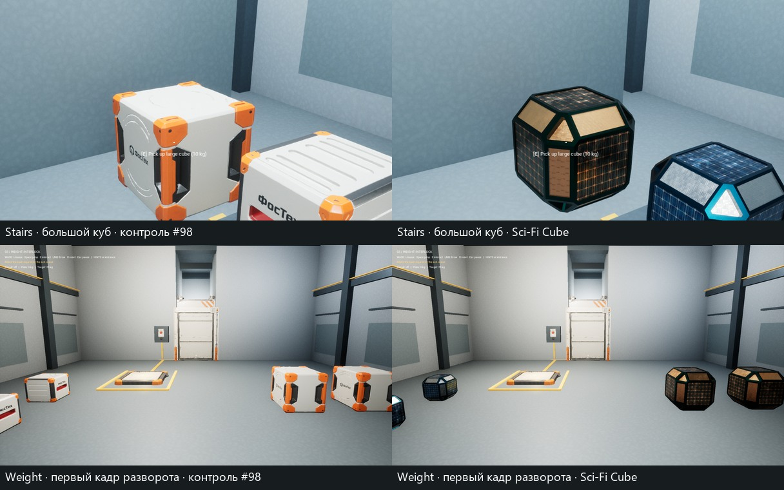

# Первый цикл Fab — балласт входного контура

24 ноября 2026 г. в игровой маршрут установлен **Sci-Fi Cube** от **Mint Chips 3D** из личной библиотеки Fab. Малый куб получил холодную светлую отделку, большой — медную. При наведении штатная подсказка сообщает тип и массу. В Stairs кубы создаются при входе. В подуровнях Button, Weight и Balance обновлены также ссылки у 2, 4 и 6 размещённых акторов. [Карточка автора](https://www.fab.com/listings/0c72f523-ff3c-4db6-b87b-79e685f30ebf) · [Титры в поставке](../Content/Credits/FabBallast.txt) · [Реестр исходников](AssetInventory.csv)

| В игре | Рёбра визуала и коллизии | Масса Chaos | Материал |
|---|---|---:|---|
| DEV-01A | 55 × 55 × 55 см | 5 кг | MI_BallastSmall |
| DEV-01B | 80 × 80 × 80 см | 10 кг | MI_BallastLarge |

Исходный FBX имеет габариты 200 × 200 × 200 см. Актор центрирует визуал и вписывает его в кубическую коллизию своего типа. Каждый меш содержит 668 исходных треугольников. Командлет проверил по 668 в собранных данных Nanite и в обычном LOD0, а также совместимость материалов. В упакованной галерее создались Nanite-прокси всех 13 экспонатов, включая оба новых куба.

Из пяти авторских карт 8192 × 8192 подготовлены три общие карты 2048 × 2048. Цвет хранится в sRGB, нормали в BC5, шероховатость, металличность и зеркальная составляющая упакованы в линейную RGB-текстуру. Оба экземпляра материала различаются оттенком краски. По списку UnrealPak контейнер новой версии содержит восемь пакетов балласта Fab. Десять пакетов двух старых моделей Meshy остались только в контрольной сборке. Файл атрибуции Fab проверен в каталоге упакованной игры. [CC BY 4.0](https://creativecommons.org/licenses/by/4.0/)

## Проверка маршрута

Собраны редактор и две Win64 Development версии на UE 5.7.4. Контроль использует игровой код и контент из #98. Обе версии прошли EntryCourse, EntryCourseAlternate, EntryCheckpoint, DoorClamp и Portals на RTX 4070 Ti SUPER, Vulkan SM6, 1920 × 1080. В Stairs куб встал на опору. В Weight открыли выход при 10 + 10 и 10 + 5 + 5 кг и повторили решение после сброса. В Balance прошли две раскладки. Сценарий продолжения загрузил контрольную точку Weight и сохранил следующую в Balance. Оба пути завершились заправкой на станции. Отдельный сценарий WristTerminal в каждой сборке подтвердил работу наруча, архива, управления и заправки. [Кадры камер, наруча и станции](Images/Fab-Ballast-Route.jpg)

На первом кадре разворота на 180° малые и большие кубы видны на своих местах. В одинаковой области 420 × 160 пикселей контрольных кадров 20–22 открытия двери сравнивалась кромка поверхности за створкой. Она появилась на тех же кадрах в обеих версиях. При первом взгляде через портал видна соседняя комната. Захват и освобождение куба дверью проверены отдельно от замеров времени кадра.

Контрольный автопрогон от готовности Stairs до пополнения кислорода занял 17,74 с реального времени, новый — 18,52 с. Сценарий использует фиксированный шаг и программно выполняет действия. Длительность первого прохождения человеком и места, где игрок обращается к подсказке, предстоит записать при пользовательской приёмке.

## Время кадра Weight

Восемь независимых запусков Win64. В каждом режиме дисплея порядок был «контроль, Fab, Fab, контроль». На втором входе в Weight пропущены 120 кадров, взяты следующие 300 на запуск. Процентили рассчитаны методом ближайшего ранга по 600 кадрам на версию и режим. Обе версии использовали штатный HZB, буфер запросов 1, High и 100% разрешения. [Идентификаторы сборок, хеши CSV, снимки и показания WDDM](Measurements/FabBallast.json)

| Режим | Пакет | Кадр p95, мс | Кадр p99, мс | Средняя частота, к/с |
|---|---|---:|---:|---:|
| Без лимита | Контроль | 6,770 | 7,072 | 163,92 |
| Без лимита | Fab | 6,630 | 7,080 | 165,69 |
| 60 к/с и VSync | Контроль | 17,149 | 17,665 | 60,00 |
| 60 к/с и VSync | Fab | 17,105 | 17,292 | 60,01 |

Самый длинный кадр из 600 при штатном лимите в версии Fab занял 17,55 мс. Пиковая выделенная видеопамять процесса на всём маршруте Stairs → Weight → Stairs → Weight составила 2965–2994 МиБ в четырёх запусках Fab и 3015–3057 МиБ в четырёх контрольных. Диапазоны относятся ко всему процессу. На стенде установлено 32 ГБ ОЗУ и 16 ГБ VRAM. Проверка на 8 ГБ системной памяти запланирована на бету.

## Повторение

Готовые игровые пакеты проекта хранятся в Git LFS. Для повторного импорта требуется исходная выдача FBX с Fab. Её SHA-256 указан в реестре. Первая команда требует Python 3.11+ и Pillow. Скрипт подготовки записывает рабочие файлы в локальный каталог AssetSource/Fab/Ballast/Prepared.

~~~powershell
python Scripts/PrepareFabBallast.py "$env:USERPROFILE/Downloads/scifi_cube.zip"
$project = (Resolve-Path Abandoned.uproject).Path
$importer = (Resolve-Path Scripts/ImportFabBallast.py).Path
& $editor $project "-ExecutePythonScript=$importer" -EnablePlugins=PythonScriptPlugin -RenderOffscreen -vulkan -unattended
~~~

Здесь переменная $editor указывает на UnrealEditor-Cmd.exe из сборки UE 5.7.4 проекта. При пересборке размещённых акторов запустите тем же способом Scripts/BuildWeightStreamingPilot.py для Weight без дополнительного флага, для двух других подуровней — с -BuildButtonRoom или -BuildBalanceRoom. Для проверки упакованной версии переменная $pkg должна указывать на каталог Windows.

~~~powershell
./Scripts/Invoke-UeVerification.ps1 -PackageRoot $pkg -Capture -Scenario EntryCourse,EntryCourseAlternate,EntryCheckpoint,DoorClamp,Portals,WristTerminal
./Scripts/Measure-VulkanPackage.ps1 -PackageRoot $pkg -Scenario FosTechGallery -GalleryNanite On
./Scripts/Measure-VulkanPackage.ps1 -PackageRoot $pkg -Scenario Travel
./Scripts/Measure-VulkanPackage.ps1 -PackageRoot $pkg -Scenario Travel -StockDisplay
~~~
