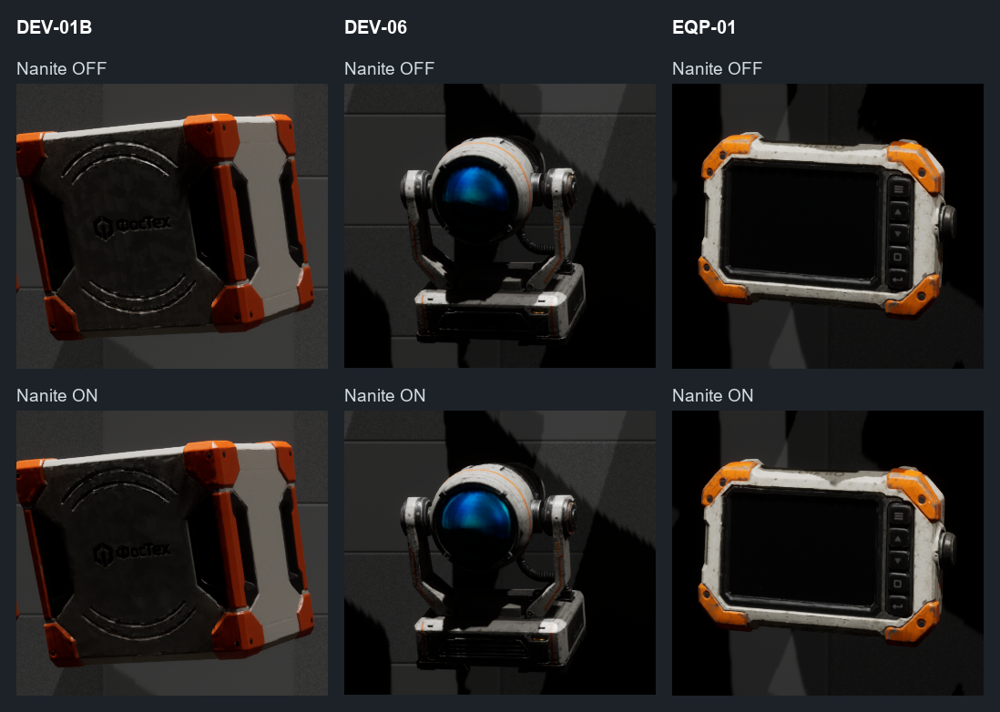

# Nanite на статических моделях ФосТех

Сравнение от 22 ноября 2026 г. охватывает десять устройств DEV, корпус терминала EQP-01 и перчатку EQP-05. У DEV-02 корпус и площадка — отдельные меши. В варианте A движок отрисовал все 13 обычными прокси, в B — 13 прокси Nanite с исходными материалами. Тело EQP-00 скелетное, дисплей терминала рисуется отдельным компонентом.

## Два пакета

Win64 Development, UE 5.7.4, Vulkan SM6, Windows 11 26300, Core i5-14400F, 32 ГБ ОЗУ, GeForce RTX 4070 Ti SUPER, драйвер 621.24. Сцена одновременно показывает все модели. Камера, масштаб каждого объекта, свет и экспозиция зафиксированы. Оконное разрешение и кадры — 1920 × 1080, профиль High, масштаб 100%. На время замера выключены VSync и ограничитель FPS.

Оба пакета содержат одни и те же текстуры и материалы. Контроль собран с выключенным Nanite на самих ассетах. Это сохраняет остальные настройки рендера и сравнивает с полноценным исходным LOD0. У игрового EXE совпал SHA-256, у контейнеров с геометрией хеши различаются. Для каждого варианта выполнен разогрев, затем восемь независимых запусков в порядке A–B–B–A–B–A–A–B. На запуск взяты 300 кадров между маркерами галереи, всего 1 200 кадров на вариант. p95 и p99 рассчитаны по объединённым кадрам методом ближайшего ранга. CPU — максимум времени игрового, рендерного и RHI-потоков для каждого кадра. Выделенную видеопамять процесса измерял Windows WDDM примерно каждые 100 мс. Снимок экрана сделан после измеряемого окна.

## Время кадра и память

| На галерее при 1080p | Обычные меши | Nanite |
| --- | ---: | ---: |
| Кадр p95 / p99, мс | 8,145 / 9,346 | 9,134 / 10,547 |
| GPU p95 / p99, мс | 7,741 / 8,618 | 8,916 / 10,000 |
| CPU p95 / p99, мс | 4,146 / 4,955 | 5,291 / 6,058 |
| Диапазон p95 кадра в четырёх запусках, мс | 7,326–8,336 | 9,043–9,216 |
| Выделенная VRAM во время замера, медиана медиан запусков, МиБ | 2 094,1 | 3 145,2 |
| Максимум VRAM в окне замера, МиБ | 2 094,1 | 3 145,3 |
| Максимум VRAM за всё время жизни процесса, МиБ | 2 124,3 | 3 220,9 |
| Объём пяти упакованных контейнеров, МиБ | 598,30 | 611,56 |

В этой сцене включение Nanite добавило 0,989 мс к p95 кадра и 1 051,1 МиБ к устойчивому расходу видеопамяти процесса. Последнее значение включает ресурсы рендерера и всего видимого содержимого. По счётчику WDDM нельзя разнести разницу по отдельным моделям или буферам. Оба p99 укладываются в 16,67 мс на проверенной машине. Потребление на видеокарте с 16 ГБ нельзя переносить напрямую на установленный минимум в 3 ГБ VRAM. Проверка минимального стенда с 8 ГБ ОЗУ остаётся задачей беты.

## Почему одного флага на меше было недостаточно

В первой сборке B у всех 13 мешей были данные Nanite, но движок отклонил их материал и создал обычные прокси. В журнале оказались предупреждения о пропущенном `bUsedWithNanite` у стандартного материала glTF и материала экипировки. Исправление сохранило три исходные карты устройств и настройки экземпляров. Проектный материал использует штатную функцию `MF_Default_Body`. На терминале добавлен вариант Nanite существующего материала отделки.

Автоматически упрощённая запасная сетка была заметна на жалюзи створки DEV-13 и кромке базы DEV-02. В итоговых ассетах сохранены исходные касательные и резервный LOD0 со всеми 1 181 797 треугольниками. При отдельном запуске итогового B с `r.Nanite=0` проверены все 13 обычных прокси. Коллизии, границы, UV и авторские текстуры сохраняются.

## Качество изображения

На большом кубе DEV-01B с Nanite темнее блики вдоль дуг тиснения. На линзе приёмника DEV-06 изменилось отражение. Силуэты, отверстия и тонкая решётка створки сохранились в проверенном ракурсе. Медианный SSIM по яркости полного кадра A/B составил 0,9842 (1 означает совпадение). При повторе одного варианта он равен 0,9997. Наибольшие различия — у DEV-01B (0,9478) и DEV-06 (0,9479). У корпуса EQP-01 — 0,9831. Области сравнения включают отбрасываемые тени. Эти оценки относятся к указанному расстоянию и освещению.

Контроль материала при обычном рендере до и после замены родительского графа дал 0,9993 для полного кадра. Принудительный обычный рендер в итоговом пакете B дал 0,9994 относительно A. [Кадр без Nanite](Images/FosTech-Gallery-Off.png) · [Кадр с Nanite](Images/FosTech-Gallery-On.png) · [Метрики всех мешей, области и хеши кадров](Measurements/FosTechGalleryVisual.json)

## Контроль в игровой камере Weight

В четырёх новых процессах (A–B–B–A) пройден измерительный маршрут Stairs → Weight → Stairs → Weight. Для каждого варианта взяты 600 установившихся кадров: по 300 начиная через 120 кадров после команды повторного входа. Пик VRAM охватывает весь маршрут. Пауза перехода в выборку времени кадра не входит.

| На повторном входе в Weight | Обычные меши | Nanite |
| --- | ---: | ---: |
| Кадр p95 / p99, мс | 6,070 / 6,750 | 10,243 / 10,883 |
| GPU p95 / p99, мс | 5,761 / 6,371 | 6,428 / 6,753 |
| CPU p95 / p99, мс | 3,134 / 3,334 | 5,537 / 6,411 |
| Пик выделенной VRAM за маршрут, МиБ | 2 179,9 | 2 984,7 |

В Weight разница p95 кадра составила +4,173 мс. В двух отдельных запусках B p95 составил 10,239 и 10,243 мс. Для повтора используйте `./Scripts/Measure-VulkanPackage.ps1 -PackageRoot <архив>/Windows -Scenario Travel`; штатный сумматор `Scripts/Summarize-VulkanProfile.py` выдаёт окно `Repeat` и пик памяти процесса. [Результаты четырёх запусков](Measurements/FosTechNaniteWeight.json)

## Откуда берутся длинные кадры в Weight

В исходном A/B медиана кадра выросла с 5,309 до 5,936 мс (+0,627 мс), а p95 — с 6,070 до 10,243 мс (+4,173 мс). В варианте B было 75 кадров длительностью от 9 мс из 600, в A — 0 из 600. Все 75 длинных кадров следовали за строкой CSV, в которой рендерный поток ждал результат GPU-запроса не менее 5 мс. Медиана этого ожидания — 6,475 мс, медиана времени в `FetchVisibilityForPrimitives` в тех же строках — 6,499 мс. В этих 75 кадрах медианное время игрового потока составило 8,884 мс в `EventWait`. Для расчёта повторно сверены SHA-256 четырёх исходных CSV. [Метрики, окна и хеши](Measurements/FosTechWeightOcclusion.json)

В UE 5.7.4 при проверке видимости примитива рендерер читает предыдущий occlusion query через `RHIGetRenderQueryResult(..., true)` (`Renderer/Private/SceneVisibility.cpp`). Если результат ещё не готов, Vulkan ждёт точку синхронизации и учитывает время в `RenderThreadIdle/GPUQuery` (`VulkanRHI/Private/VulkanQuery.cpp`). В Weight включение Nanite увеличивает работу графа рендера (медиана 261 → 364 прохода RDG). С буфером запросов в один кадр ожидание результата видимости задерживает конвейер, что видно в хвосте времени кадра. Времена параллельных потоков и GPU перекрываются.

Для проверки пути рендера на тех же архивах выполнены шесть запусков с GPU-счётчиками в порядке A, B, B с `r.Nanite=0`, B с `r.Nanite=0`, B, A. По вариантам A / B / B с резервной геометрией p95 кадра составил **5,857 / 9,895 / 6,164 мс**. В B p95 прохода `GPU/NaniteVisBuffer` составил 0,923 мс, `GPU/NaniteBasePass` — 0,130 мс. Это времена отдельных проходов. Замер не определяет вклад конкретного меша ФосТех в задержку.

## Предложение на согласование

**Испытать в игровом профиле Vulkan SM6 буферизацию запросов видимости на два кадра** (`r.NumBufferedOcclusionQueries=2`). В контрольном опыте на пакете B все 13 статических мешей сохранили Nanite. Изменялся только параметр запуска процесса. Четыре процесса прошли один маршрут в порядке 1–2–2–1, без дополнительных GPU-счётчиков, по 300 установившихся кадров на втором входе. В журналах подтверждены глубина буфера, `r.Nanite=1` и `r.HZBOcclusion=0`.

| Weight, пакет B | 1 кадр (штатно) | 2 кадра (опыт) |
| --- | ---: | ---: |
| Кадр p95 / p99, мс | 10,362 / 11,310 | 6,756 / 7,278 |
| GPU p95, мс | 6,469 | 6,505 |
| Ожидание событий игровым потоком p95, мс | 9,173 | 5,530 |
| Ожидание GPU-запроса рендерным потоком p95, мс | 6,754 | 6,366 |
| Кадры от 9 мс | 79 / 600 | 0 / 600 |

Дополнительный кадр буферизации дал **−3,606 мс (−34,8%)** по p95 при близком времени GPU. Ожидания GPU-запросов сохраняются, но реже задерживают выдачу следующего кадра. Это объясняет основную часть исходного роста p95 и позволяет сохранить качество моделей. Цена настройки — решение о видимости может использовать результат на кадр старше. Эффект измерен на RTX 4070 Ti SUPER в фиксированном ракурсе Weight.

Для воспроизведения используйте аргументы сценария `Travel` из `Scripts/Measure-VulkanPackage.ps1`. Перед командой `CsvProfile FRAMES=2200` в `-ExecCmds` задайте `r.NumBufferedOcclusionQueries 1,r.NumBufferedOcclusionQueries` или то же со значением `2`. Для отдельной серии со счётчиками добавьте `r.GPUCsvStatsEnabled 1`, для контроля резервной геометрии пакета B — `r.Nanite 0`. Считайте перцентили ближайшего ранга по объединённым интервалам `Repeat`.

Отдельный прогон `Campaign` с буфером 2 завершил маршрут через пролёт и пополнение на станции. После согласования сравнить 1 и 2 при штатных VSync и лимите 60 к/с, а также без лимита. В движении проверить быстрый разворот, выход из-за створки, появление куба, разметки и показаний плиты в Weight, вид через портал. Предлагаемый критерий для этой машины — p95 до 7 мс и p99 до 8 мс без лимита при сохранении видимости игровых сигналов во всех этих ракурсах. При запоздалом появлении геометрии оставить штатное значение 1. Проверка минимума с 8 ГБ системной памяти остаётся на бету.

## Игровая проверка

В итоговом пакете прошли Dev20, StationAirlock, StationAirlockMissingSupply, VulkanExitControl, EntryCourse, WristTerminal, DoorClamp и Portals. В контрольном пакете отдельно повторён WristTerminal. На обоих вариантах проверка зарегистрировала светящиеся строки во всех четырёх игровых кадрах со статусом, поднятой рукой при наклоне камеры на 45°, вспышкой и архивом. [Наручный терминал от первого лица, фрагмент кадра 1:1](Images/FosTech-Nanite-Wrist.png) · [Проверки, хеши пакета и журналов](Measurements/A11-NaniteHandoff.json)

## Воспроизведение

1. Получите ассеты Git LFS. В UE 5.7.4 соберите Win64 Development с `BuildCookRun -platform=Win64 -clientconfig=Development -build -cook -stage -pak -package -archive` и отдельным `-archivedirectory` для B.
2. Для A в отдельной рабочей копии той же ревизии выполните `UnrealEditor-Cmd Abandoned.uproject -run=pythonscript -script=<абсолютный путь к Scripts/ConfigureFosTechNanite.py> -DisableFosTechNanite -EnablePlugins=PythonScriptPlugin -unattended -nullrhi`. Соберите и архивируйте пакет A той же командой. Для сравнения сохраните одинаковый бинарник игры и раздельные каталоги контента.
3. Выполните `./Scripts/Measure-VulkanPackage.ps1 -PackageRoot <архив>/Windows -Scenario FosTechGallery -GalleryNanite On` для B, с `-GalleryNanite Off` для A. Пропустите первый прогрев каждого варианта. Скрипт выводит каталог прогона, проверяет путь рендера всех мешей и записывает сведения о пакете.
4. Передайте каталоги измеренных прогонов в порядке съёмки в `python Scripts/Summarize-FosTechGallery.py <каталоги>`. Скрипт проверяет границы интервала, одинаковый EXE, разрешение и хеши контейнеров внутри каждого варианта. [Числа по запускам и хеши исходных CSV](Measurements/FosTechNanite.json)
