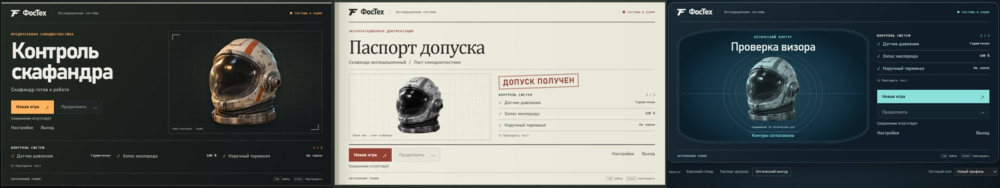

# Главное меню и самодиагностика скафандра

Для главного меню утверждён третий вариант реализации. Композицию и переходы экрана выбираем в автономном HTML. Главное меню игры реализуем на UMG/Slate. Сейчас игра сразу открывает кампанию, а Esc вызывает существующую паузу на Slate. Три макета ниже позволяют выбрать художественное решение перед сборкой виджета.

## Три варианта прибора

| Макет | Что видит игрок | Полноразмерный снимок |
| --- | --- | --- |
| [Бортовой стенд](MenuPrototypes/stand.html) | Тёмная приборная панель с янтарной кнопкой запуска. Справа шлем установлен в контрольную рамку, снизу в одну строку вынесены результаты проверки. | [Открыть снимок](MenuPrototypes/stand.jpg) |
| [Паспорт допуска](MenuPrototypes/passport.html) | Электронная копия светлого заводского бланка. Визуальный центр — красная отметка о допуске рядом с перечнем проверенных узлов. | [Открыть снимок](MenuPrototypes/passport.jpg) |
| [Оптический контур](MenuPrototypes/visor.html) | Силуэт шлема совмещён с осью калибровки. Команды и показания помещены справа, как на окулярном стенде. | [Открыть снимок](MenuPrototypes/visor.jpg) |

Откройте любой HTML из папки `Docs/MenuPrototypes` локальной копии. Все варианты используют общие CSS, JavaScript и иллюстрацию из этой папки. Нижняя полоса «Макеты» переключает варианты и тестовый слот. Выбранное состояние переносится между вариантами. Иллюстрация шлема создана средствами ImageGen специально для макетов. Художественный облик игровой модели требует отдельного утверждения.

## Сценарий просмотра

1. При новом профиле доступна «Новая игра». В полосе просмотра выберите «Есть сохранение», чтобы открыть «Продолжить». При попытке начать заново прибор запрашивает подтверждение. Для повреждённого слота дисплей объясняет, почему доступна только новая игра.
2. Нажмите «Повторить тест». По очереди появляются результаты проверки герметичности, кислорода и связи с наручным терминалом. Пока идёт диагностика, запуск кампании заблокирован.
3. В «Настройках» проверьте вертикальную синхронизацию и лимит 30, 60, 120 или 180 к/с. По умолчанию выбраны VSync и 60 к/с. Параметры принадлежат сеансу просмотра макетов.
4. Tab и Shift+Tab перемещают фокус, Enter подтверждает, Esc закрывает диалог. После выхода прибор можно включить снова. Запуск и продолжение показывают точку передачи управления игре. Игровые файлы сохранения в просмотре не используются.

## Граница между прибором и игрой

До выбора игрока главное меню должно проверить пригодность слота. Кампанию и запись контрольной точки запускает C++ через существующие сценарии игры. При переходе в пролог рисунок панели можно перенести на поверхность скафандра через Widget Component в мировых координатах. [Widget Components в UE 5.7](https://dev.epicgames.com/documentation/en-us/unreal-engine/widget-components-in-unreal-engine?application_version=5.7)

Внутри кампании кислород, доза, прогноз и архив остаются на запястье. Питание и состояние оптики и порталов находятся на соответствующих устройствах. Наручный терминал позволяет двигаться. Esc ставит одиночную игру на паузу и даёт прямой доступ к настройкам и выходу. Обязательные сигналы имеют форму или подпись, читаемую при слабом освещении. [Правила механик](MechanicsDecisions.md) · [Наручный терминал](Vanguard.md#наручный-терминал) · [Правила сигналов](Design.md)

Страница работает офлайн в браузере для художественного согласования. Выбранный путь сохраняет штатный обработчик ввода и настроек UE. При переносе в игру нужно сверить русский текст, фокус клавиатуры и геймпада, новый, пригодный и несовместимый слоты, паузу и возврат из меню в пакете Win64 Vulkan.
