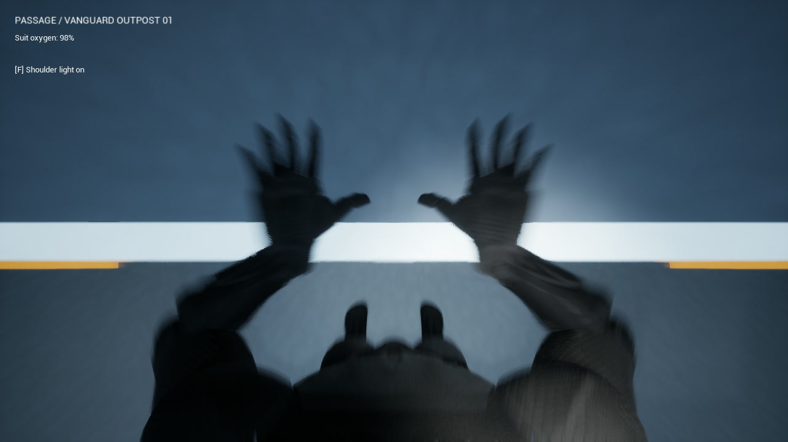

# Захват уступа на Custom Manny V2

После примерки поясного КПК в [PR #106](https://github.com/hhypest/abandoned/pull/106) тот же персонаж проходит обязательный уступ между Balance и станцией «Авангард». Для запуска непосредственно в переходе выполните команду из каталога упакованной игры.

```powershell
& ./Abandoned.exe "/Engine/Maps/Entry?game=/Script/Abandoned.VanguardRouteGameMode?Chamber=Passage" -CustomMannyFit -vulkan
```

У кромки удерживайте пробел. Если открыт архив, перед первым контактом герой убирает Rugged Tablet на пояс. После подъёма можно продолжать идти или снова достать КПК по Tab. Включённый плечевой фонарь приглушается рядом с руками и экраном. После закрытия КПК возвращается его походная яркость.

## Положение рук

Для касания использована поза 03 из библиотеки 60 Finger Poses от Attaku. Подготовщик перенёс вращения 30 суставов в локальные системы костей Custom Manny V2. Поза задаёт раскрытие кистей, а игровой расчёт подводит ладони к двум точкам на кромке и укладывает пальцы на верхнюю грань. Подъём использует существующую траекторию капсулы и действующие проверки препятствий. [Происхождение и лицензия](../Content/Credits/SuitFit.txt)



[КПК после приземления с включённым фонарём](Images/CustomManny-LedgeArchive.jpg)

## Что измеряет игровой тест

- Перед подъёмом персонаж открывает архив по Tab. Ходьба, короткий прыжок, прыжок с приседом и удержание пробела при занятом месте приземления оставляют его перед уступом.
- Между 0,14 и 0,25 с после начала подъёма тест сравнивает точки кожи обеих ладоней с физической кромкой. Допуск 5 мм. Для указательного и среднего пальцев каждой руки дистальный сустав должен находиться за кромкой на высоте 0,2–3 см над верхней гранью. На тех же кадрах проверяется положение КПК относительно таза.
- После приземления тест сравнивает поворот и положение обоих запястий с исходной стойкой, открывает и убирает архив по Tab, проверяет яркость включённого фонаря и доходит до заправки кислорода на станции.

## Результат 26 ноября 2026 г.

В Win64 Development на UE 5.7.4, Vulkan SM6 и RTX 4070 Ti SUPER обе проверки контакта дали максимальную ошибку 0,00 см с точностью журнала 0,01 см. Проверены 1280 × 720 с фиксированным шагом 60 Гц и 1920 × 1080 с шагом 120 Гц. При первом переносе позы левая ладонь промахнулась на 5,14 см. После корректировки высоты таза и положения плеч обе ладони попадают на кромку, а четыре проверяемых пальца проходят допуск по высоте.

При повторном открытии архива обнаружена засветка от плечевого фонаря. На приведённом выше игровом кадре фонарь включён, текст читается, после закрытия тест подтвердил восстановление полной яркости. В этой примерке участвуют кистевая поза 03 и игровая анимация подъёма. Полнотелый клип из Free Animation Library остаётся кандидатом для отдельной примерки.

SHA-256 проверенной программы — `81F448849ED26FE8D6069E0BA2D7A82510B7C1E2DB4E31784BCC2A280886A9A7`. При выходе Vulkan повторил известное по предыдущей сборке предупреждение `Found 1 unfreed allocations!`.

В контрольном запуске с пустой ссылкой на позу 03 игра выбрала EQP-00, штатный наруч и прошла до заправки на станции. Один ранний запуск этого контроля одновременно с другими процессами UE завершился исключением в модуле `nvwgf2umx`. При отдельном запуске на итоговой сборке ошибка не повторилась. Причина исключения не установлена.

## Воспроизведение сборки

Подготовьте локальные модель, хват куба и КПК по [инструкции к поясной примерке](BeltTabletFit.md#воспроизведение). Перед упаковкой выполните из корня проекта дополнительный импорт позы 03. Готовый пакет позы попадает в уже включённый каталог `CubeGrip`. Ассеты издателей остаются в локальной библиотеке владельца.

```powershell
$ue = 'C:/Program Files/Epic Games/UE_5.7/Engine'
& "$ue/Binaries/Win64/UnrealEditor-Cmd.exe" "$pwd/Abandoned.uproject" "-ExecutePythonScript=$pwd/Scripts/PrepareCubeGrip.py" -CustomMannyFit -PrepareLedgePose -EnablePlugins=PythonScriptPlugin -NoSourceControl -unattended -nullrhi
```

После упаковки укажите каталог с `Abandoned.exe` и запустите сценарий. Он сохраняет кадры подхода, хвата, выхода наверх и повторного открытия КПК, журнал игры и отчёт в `Saved/UeVerification`.

```powershell
& ./Scripts/Invoke-UeVerification.ps1 -PackageRoot ./Saved/LedgeFit/Release/Windows -Scenario CustomMannyLedge -FramesPerSecond 60 -Resolution 1280x720 -Capture
& ./Scripts/Invoke-UeVerification.ps1 -PackageRoot ./Saved/LedgeFit/Release/Windows -Scenario CustomMannyLedge -FramesPerSecond 120 -Resolution 1920x1080 -Capture
```
