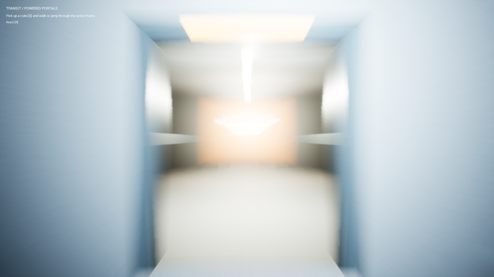
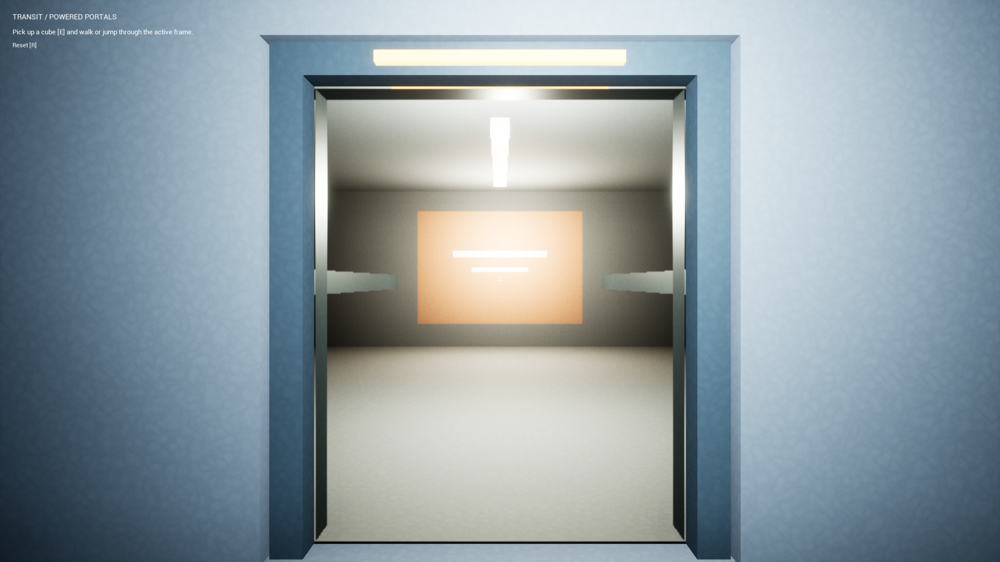
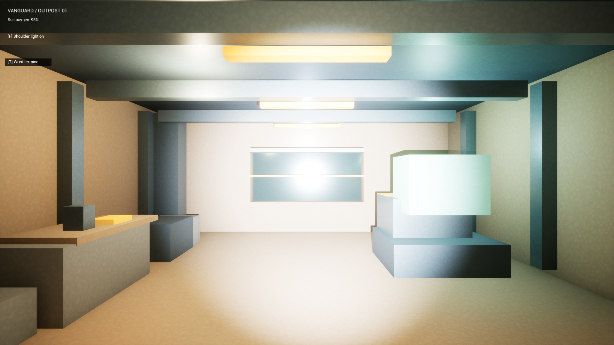

# Проверка графического профиля Vulkan SM6

17 ноября 2026 г. Проверен коммит `87de2d223e90956a24c538add1a3c1fb72f1f801` с чистыми отслеживаемыми файлами. Результат относится к `UnrealEditor.exe -game`, Development. [Профиль и рекомендованная конфигурация](Rendering.md)

## Среда

- Windows 11 x64, build 26300.10066; UE 5.7.4.
- Intel Core i5‑14400F, 32 GB RAM, GeForce RTX 4070 Ti SUPER, драйвер 621.24.
- `AbandonedEditor Win64 Development` собран MSVC 14.44 и Windows SDK 10.0.26100.0.
- Vulkan RHI, API 1.3, `VULKAN_SM6`. D3D не использовался.

## Прогоны

| Сценарий | 1920 × 1080, шаг 1/60 с | 1280 × 720, шаг 1/120 с |
| --- | --- | --- |
| Входной контур, уступ, шлюз, станция и снабжение | Passed | — |
| Радиационный пролёт и наручный терминал | Passed | — |
| Терминал с пустым архивом, отрицательный контроль | ExpectedFailure | — |
| Зажим, запрет захвата, освобождение, E, R, возврат игрока | Passed | Passed |
| Портал, физический перенос и показ связанной комнаты | Passed | Passed |

Во всех прогонах подтверждены `r.DynamicGlobalIlluminationMethod=1`, `r.ReflectionMethod=1`, `r.GenerateMeshDistanceFields=1`, `r.Lumen.HardwareRayTracing=0`, `r.Nanite.ProjectEnabled=1`, `r.Shadow.Virtual.Enable=1`, `r.AntiAliasingMethod=4`, `sg.GlobalIlluminationQuality=2`, `sg.ReflectionQuality=2`. Несовпадений профиля нет.

Отрицательный контроль зарегистрировал предусмотренную ошибку пустого архива и запрос завершения со статусом 1. Сам процесс UE вернул 0. Запускатель распознал `ExpectedFailure` по журналу. Положительные сценарии завершились с кодом 0 и полным набором маркеров.

Вынесенная проверка зажима подтвердила неподвижность створки и предмета, две предупреждающие надписи, отказ захвата через E, восстановление массы и захвата после открытия, сброс через R и возврат игрока к точке входа.

Автономные C++20-тесты имеют 20 именованных групп. Они прошли с `NDEBUG` и без него; намеренная ошибка дала ненулевой код в обоих вариантах. Git LFS прошёл проверку семи бинарных ассетов. Обязательный CI для проверенной ревизии: [C++20 and Git LFS](https://github.com/hhypest/abandoned/actions/runs/44154859123).

Локальные отчёты и журналы:

- `Saved/UeVerification/20261117-190545-9eb6c8e9a36240b7b5f0a0edc9e51df7/report.json` — полный набор 60 Гц.
- `Saved/UeVerification/20261117-190728-4ae0caa9fbb848adb82162a08ffe6591/report.json` — зажим и порталы, 120 Гц.

## Проверка изображения

Первый просмотр PNG обнаружил заглушку при правильном содержимом render target. В последующих запусках прежняя инициализация давала оба результата. Выборка RGB `205,211,216` на заглушке давала отказ, а `248,224,198` на стене связанной комнаты — успех. Теперь при загрузке карты движок завершает подготовку материала и обновление текстуры на RHI до привязки материала. При появлении входа он отправляет первый захват связанной комнаты до показа поверхности. Запускатель проверяет первый видимый кадр и кадр после включения. [Протокол холодных запусков](Testing.md)

На проверенных кадрах читаются жёлтые рамки, предупреждение зажима и содержимое портала. Свет и поверхности пока относятся к блокауту. Для художественной приёмки нужны финальные модули, проверка световых утечек, иерархия освещения и контраст обязательных сигналов в тёмных участках.

## Первый показ портала

18 ноября 2026 г. на коммите `e8b11b4` выполнены шесть последовательных запусков `UnrealEditor -game` на GeForce RTX 4070 Ti SUPER, Vulkan SM6, High. Каждый запуск использовал отдельный процесс и новый профиль. Все шесть журналов подтвердили отсутствие файла `VulkanPSO.cache` в профиле. Общий DDC и системный кэш драйвера сохранялись.

| Разрешение и шаг | Успешные запуски | RGB стены в первом видимом кадре | RGB стены через 0,5 с |
| --- | --- | --- | --- |
| 1920 × 1080, 1/60 с | 4 из 4 | 253, 235, 216 | 249, 225, 199 |
| 1280 × 720, 1/120 с | 2 из 2 | 253, 237, 219 | 248, 223, 197 |

На первом кадре видны боковые стены и освещённая панель связанной комнаты. В момент съёмки тестовый персонаж только что переместился к входу, поэтому виден след размытия от движения камеры. Сохранённый кадр со старой заглушкой на `7849e17` та же проверка отклоняет при RGB 206, 212, 216. Во всех шести запусках пройден и игровой сценарий порталов, включая перенос куба и сохранение скорости.

## Ограничения и следующий контроль

При завершении UE журнал сообщает `Suballocation(s) for Buffer ... were not released` и `unfreed PooledBuffer resources`, включая строки `LEAK`. Запускатель сохраняет все предупреждения RHI в `RhiWarnings`. Они требуют отдельной локализации и проверки полного жизненного цикла рендер-ресурсов. Наличие или отсутствие накопления памяти при продолжительной игре этим прогоном не установлено.

В текущей рабочей копии отсутствуют приватные пакеты `/Game/AbandonedLocal/Vanguard`. Поэтому журнал пролёта сообщает `frame=fallback, leaf=fallback, Fab floor=fallback, Fab walls=fallback`. Проверены маршрут и базовые материалы. Чистовой пролёт с рамой, створкой и Fab проверяется отдельно после [восстановления локального импорта](Vanguard.md#локальные-ассеты-пролёта).

Первый запуск нового профиля потребовал примерно 57 минут подготовки глобальных шейдеров и базовых материалов. Последующие прогоны использовали кэш. Это время подготовки среды разработки учитывается отдельно от игровых переходов.

Фиксированный шаг симуляции не измеряет FPS. Рабочая цель 1080p/High/60 FPS и рекомендованные 16 GB RAM / 8+ GB VRAM ещё требуют упакованной сборки и замеров на RX 6800, RTX 3070 и Arc B580. Для Nanite также нужна проверка конкретных импортированных мешей; включение поддержки проекта само по себе её не заменяет.

## Упакованная игра и память Vulkan

19 ноября 2026 г. на ревизии `1a02f1e` собрана и проверена Win64 Development из публичного контента Git LFS. UE 5.7.4, Windows 11 Pro x64, Core i5‑14400F, 32 ГБ RAM, GeForce RTX 4070 Ti SUPER (драйвер 621.24), Vulkan SM6, 1920×1080, High. Cook обработал 448 пакетов с нулём ошибок и предупреждений. Архив Windows занял 2,66 ГиБ, включая 2,07 ГиБ символов отладки. SHA‑256 внутреннего `Abandoned.exe` равен `87817C8BD256B4BC472DA59EA742B024BDAB84E0F646CE488BA12FCBC715446F`. [Команды упаковки и запуска](Testing.md#упакованная-игра-win64-development)

**Кампания.** Новый профиль прошёл Stairs → Button → Weight → Balance → пролёт → станция. Независимый процесс загрузил Save v2 из Weight, прошёл Balance и добрался до подачи кислорода. В слоте проверены версия 2, точка Balance и единственная запись `oxygen-restored`. В пролёте использовались резервные рама, створка, пол и стены. В пакет вошли рукава, перчатки и звук травмы. Прошли Gravity и проверка декодирования звука при падении. Отрицательный контроль неверного порога веса дал ожидаемый отказ.

**Портал.** В первом пакете проверка отклонила пустой проём на первом видимом кадре (RGB 36, 56, 74), хотя на установившемся кадре уже была связанная комната. Две поверхности проёмов теперь создают объект для отрисовки сразу, пока UE продолжает предварительную подготовку графических конвейеров. На итоговом пакете три отдельных процесса с чистыми профилями показали связанную комнату и прошли перенос предмета. Красный канал контрольного пикселя первого кадра составил 244–245, синий 180–181. Кэш драйвера между запусками сохранялся.

**Удержание памяти.** На карте Entry со стандартным `GameModeBase` один и тот же процесс дважды выполнил `open`. Запрос `rhi.DumpResourceMemory all Name=PhysicsField_ClipmapBuffer` на первой и третьей загрузках дал следующие результаты.

| Настройка пакета | Первая загрузка | Третья загрузка | Строки LEAK после третьей загрузки |
| --- | ---: | ---: | ---: |
| Прежнее значение, `r.PhysicsField.EnableField=1` | 1 буфер, 10 МиБ | 3 буфера, 30 МиБ | 52 |
| Профиль проекта, `r.PhysicsField.EnableField=0` | 0 | 0 | 49 |

Стеки создания ведут к `FPhysicsFieldResource::InitRHI`. Текущие игровые механики используют тела Chaos и собственную область гравитации. Отключение GPU-поля устранило выделение этих буферов при каждой загрузке. Для воспроизведения прежней конфигурации запустите внутренний exe с аргументами из `Game.log` сценария VulkanTravelControl, задайте новый `-UserDir` и `-abslog` и добавьте `-ini:Engine:[SystemSettings]:r.PhysicsField.EnableField=1`.

**Исходный замер PR #53.** При штатном выходе с кодом 0 одна загрузка стандартной карты дала 31 строку `LEAK`, три загрузки дали 49. В обоих случаях было по три сообщения `unfreed PooledBuffer` и по три `Suballocation(s) for Buffer`. Разница в 18 строк приходится на две группы стеков выделения объёмного освещения. На каждую дополнительную загрузку приходятся восемь текстур из `FVolumetricLightmapBrickTextureSet::Initialize` общим объёмом 32 КиБ и одна из `FPrecomputedVolumetricLightmapData::AddToSceneData` объёмом 16 КиБ. Полный маршрут дал 78 строк `LEAK`, восстановление — 60. Количество строк и байты, указанные аллокатором UE, не измеряют физическую VRAM процесса. Владельца ссылки и повторные переходы проверили в следующем прогоне.

В основном прогоне время внутри `LoadMap` составило 23,8 мс при входе в пролёт и 19,4 мс при входе на станцию. Это два наблюдения с фиксированным шагом симуляции. Для бюджета кадра остаются серии холодных и тёплых переходов в реальном времени, CPU/GPU p95/p99, пики RAM/VRAM и отдельное сравнение активного портала на рекомендованном оборудовании. Дополнительно штатный запускатель Windows прошёл тот же маршрут в реальном времени, выбрав карту и Vulkan из конфигурации. Сохранена трасса Unreal Insights с каналами cpu, gpu, frame, bookmark и loadtime (169,6 МиБ). Для повторения передайте запускателю -VerifyEntryCourse, -trace=cpu,gpu,frame,bookmark,loadtime и -tracefile с абсолютным путём к файлу .utrace.

## Владелец текстур объёмного освещения

19 ноября 2026 г. на третьей загрузке `/Engine/Maps/Entry` со стандартным `GameModeBase` RHI показал 27 живых текстур `VolumetricLightmap`. Дамп упакованного процесса из PR #53 разобран с соответствующим `Abandoned.pdb`. В таблицах ресурсов двух старых `FVulkanUniformBuffer` с раскладкой `FViewUniformShaderParameters` находилось по девять разных текстур. У каждой из этих 18 текстур оставалась ровно одна сильная ссылка. В каждой группе восемь текстур атласа по 4096 байт и одна текстура индирекции на 16 384 байта.

Владелец каждого старого буфера вида — поле `FNiagaraAsyncGpuTraceProviderGsdf::m_ViewUniformBuffer`. Тип провайдера в дампе установлен по таблице виртуальных функций. В UE 5.7.4 его `PostRenderOpaque` копирует `Views[0].ViewUniformBuffer` даже в контрольном мире без игровых эффектов. Профиль проекта задаёт `fx.Niagara.AsyncGpuTrace.GlobalSdfEnabled=0`, поэтому Niagara пропускает создание этого неиспользуемого провайдера при инициализации мира. Поддержка запечённого освещения включена (`r.AllowStaticLighting=1`), Lumen и сами объёмные карты активного мира сохранены.

**Контроль на GPU.** Windows 11 Pro x64, UE 5.7.4, Win64 Development, Vulkan SM6, RTX 4070 Ti SUPER, драйвер 621.24, 1920×1080 High. Один процесс 12 раз переоткрывал Entry. Снимки `rhi.DumpResourceMemory all Name=VolumetricLightmap` сняты после загрузки и нескольких десятков кадров отрисовки. В таблице указано количество живых текстур и общий объём их выделений RHI.

| Пакет и провайдер GSDF | Первая загрузка | После 2 переходов | После 12 переходов | Строки `LEAK` при выходе |
| --- | ---: | ---: | ---: | ---: |
| Пакет PR #53, включён | 9 / 48 КиБ | 27 / 144 КиБ | 117 / 624 КиБ | 139 |
| Профиль `325b467`, выключен | 9 / 48 КиБ | 9 / 48 КиБ | 9 / 48 КиБ | 0 |
| Тот же пакет, снова включён аргументом запуска | 9 / 48 КиБ | 27 / 144 КиБ | 117 / 624 КиБ | 139 |

В рабочем профиле все 13 замеров дали по девять текстур. Контроли с одним и тринадцатью мирами завершились с кодом 0, без сообщений аллокатора об оставшихся изображениях или буферах. Для обратного контроля повторите команду из `VulkanTravelControl/Game.log` с новым профилем и журналом, добавив `-ini:Engine:[SystemSettings]:fx.Niagara.AsyncGpuTrace.GlobalSdfEnabled=1`. [Команды упаковки и сценарий регрессии](Testing.md#упакованная-игра-win64-development)

**Кампания и порталы.** Штатный запускатель Windows без флага RHI выбрал Vulkan SM6 и прошёл маршрут до пополнения кислорода на станции в реальном времени. В готовом пакете прошли `EntryCourse`, `EntryCheckpoint`, `WristTerminal`, `DoorClamp` и `Portals`. Портал показал связанную комнату в первом видимом кадре (контрольный RGB 245, 214, 181), затем прошёл проверку переноса. Полный cook обработал 448 пакетов, включая 7 пропущенных для платформы, с нулём ошибок и предупреждений. SHA‑256 `Abandoned-Windows.pak` с настройкой проекта — `A180EAF226FEC0FBE330B4F3007D1C69E37D954C75D6C4584F6CD45E1B534943`.

В пакете PR #54 в каждом из пяти игровых сценариев при выходе остались три записи `LEAK` (один `MultiBuf` и два `ImageRT`). Их владельца установили в следующем прогоне. A‑07 также включает профилирование кадра и переходов на рекомендованных GPU.

## Выход из кампании и глобальное поле расстояний

19 ноября 2026 г. после двух загрузок игрового мира и перехода на Entry со стандартным `GameModeBase` в дампе пакета PR #54 остались два объекта `FNiagaraGpuComputeDispatch` с `bIsPendingKill=1`. С символами соответствующего `Abandoned.exe` обе цепочки прослежены от поля `CachedGDFData` до одних и тех же ресурсов RHI. Их имена и размеры совпали с инвентаризацией `rhi.DumpResourceMemory all` и стеками трёх выделений Vulkan при выходе.

| Запись Vulkan | Поле кэша Niagara | Ресурс | Размер |
| --- | --- | --- | ---: |
| MultiBuf | `PageObjectGridBuffer` через `FRDGPooledBuffer::Buffer` | `GlobalDistanceField.PageObjectGridBuffer` | 117 440 512 Б |
| ImageRT | `MipTexture` | `GlobalDistanceField.SDFMips` | 1 048 576 Б |
| ImageRT | `PageTableTexture` | `GlobalDistanceField.PageTableCombined` | 1 105 920 Б |

В UE 5.7.4 диспетчер копирует ссылки на поле расстояний из отрисованного вида в `PostRenderOpaque` для возможного принудительного выполнения тиков симуляции. Кэш заполняется и в мирах без Niagara-эффектов. В отдельном игровом процессе Abandoned снимает регистрацию фабрики этого диспетчера до первого мира. На исправленном пакете все три ресурса присутствовали при отрисовке кампании с Lumen и освободились к моменту проверки аллокатора при выходе.

**Сравнение пакетов.** Windows 11 Pro x64, UE 5.7.4, Win64 Development, Vulkan SM6, RTX 4070 Ti SUPER (621.24), 1920×1080 High. В каждой строке один процесс прошёл весь сценарий и завершился с кодом 0. Числа в двух правых столбцах взяты из строк `** LEAK` после завершения игры.

| Сценарий | Загрузок мира | PR #54 | Исправление `12b82d0` |
| --- | ---: | ---: | ---: |
| Кампания от Stairs до кислородной стойки (`EntryCourse`) | 6 | 3 | 0 |
| Загрузка сохранения из Weight, переходы до станции (`EntryCheckpoint`) | 4 | 3 | 0 |
| Повторный вход в игровые режимы (`WorldLifetime`) | 11 | 3 | 0 |
| Контроль со стандартным GameModeBase (`VulkanTravelControl`) | 13 | 0 | 0 |

Во всех четырёх сценариях нового пакета счётчики `PooledBuffer`, `Image`, `BufferNotReleased` и `LeakEntries` равны нулю. В контроле сохранились девять активных объёмных текстур на каждой из 13 загрузок. Прошли также альтернативное решение кампании, терминал, зажим двери и портал с проверкой первого кадра и переноса. Отрицательный контроль неверного веса дал ожидаемый отказ. SHA‑256 игрового exe — `851276ECDBC60C0116F952D57FF69FAC3B1A0E5AC13374DE22970C880AF9B215`. [Команды проверки упакованной игры](Testing.md#упакованная-игра-win64-development)

При завершении `FDeviceMemoryManager::Deinit` остаётся отдельное предупреждение `Found 1 unfreed allocations!`, в том числе при запуске только пустого мира. Оно относится к учёту выделений по кучам устройства. Результат следующей проверки приведён ниже.

## Глубина сцены при выходе

На пакете PR #55 выход из пустой карты Entry со стандартным `GameModeBase` и выход со станции в конце кампании воспроизводили одну и ту же проблему. На куче 0 после завершения рендера оставалось одно выделение в 17 694 720 Б (16,875 МиБ при 1920×1080). Vulkan дважды выводил `Found 1 unfreed allocations!` с одним и тем же дескриптором в пределах процесса. Устройство вызывает `FDeviceMemoryManager::Deinit()` явно, затем деструктор менеджера вызывает её повторно.

В отдельном диагностическом запуске без Lumen Reflections единственной текстурой такого размера в инвентаризации RHI была `SceneDepthZ`, а предупреждение сохранилось. При отключении выделенной памяти изображений в другом запуске аллокатор показал `ImageRT` того же размера. Оба эксперимента проведены на старом пакете. Итоговый пакет использует штатные настройки изображений и Lumen Reflections.

В UE 5.7.4 глобальный `FSceneTextureExtracts` извлекает текстуры глубины для использования после выполнения графа рендера. В проверенном пути deferred-рендера `PartialDepth` ссылается на ту же текстуру, что и `Depth`. В `Release()` очищались `Depth`, `CustomDepth` и оба uniform-буфера, но оставалась ссылка `PartialDepth`. Теперь владелец освобождает её там же, в том числе при вызове `ReleaseRHI()`. Поправка в одну строку применяется к исходной сборке Renderer. [Воспроизведение сборки](../CONTRIBUTING.md#исправление-renderer-в-ue-574)

**Сравнение упакованных Win64 Development.** Windows 11 x64, RTX 4070 Ti SUPER, драйвер 621.24, Vulkan SM6, 1920×1080 High. На обоих пакетах кампания дошла до станции, и процесс завершился с кодом 0. Усиленная проверка на старом пакете отклонила оба выхода из-за предупреждений памяти устройства.

| Сценарий | Загрузок мира | Сообщения `Found N unfreed allocations!` до → после | Записи `** LEAK` до → после |
| --- | ---: | ---: | ---: |
| Пустая карта с `GameModeBase` | 1 | 2 → 0 | 0 → 0 |
| Кампания до кислородной стойки на станции | 6 | 2 → 0 | 0 → 0 |

В новом пакете прошли 12 перезагрузок пустой карты (по девять активных текстур объёмного освещения на всех 13 загрузках), 10 смен игровых режимов, восстановление из Weight и альтернативное решение кампании. Прошли проверки портала, наручного терминала и зажима двери. Отрицательный контроль неверного веса дал ожидаемый отказ. Пять счётчиков аллокатора равны нулю во всех десяти сценариях.

SHA‑256 игрового exe после пересборки — `A723C40209C34C03FFFEBA5937A10098D06F306C2AD3BC75FE299936318D56B4`. Для проверки используйте один пакет для обоих сценариев и сохраняйте `report.json` вместе с журналами. [Команды и значения счётчиков](Testing.md#упакованная-игра-win64-development)

Сравнение времени кадра CPU и GPU, пиков памяти процесса и стоимости портального захвата приведено в [отдельном протоколе измерений A‑07](A07Performance.md).
