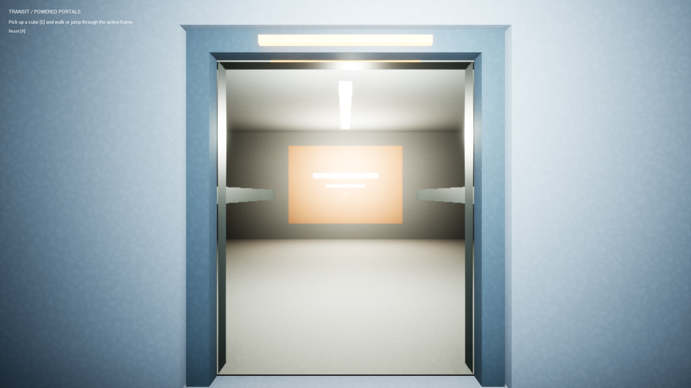

# Проверка графического профиля Vulkan SM6

17 ноября 2026 г. Проверен коммит `87de2d223e90956a24c538add1a3c1fb72f1f801` с чистыми отслеживаемыми файлами. Результат относится к `UnrealEditor.exe -game`, Development. [Профиль и рекомендованная конфигурация](Rendering.md)

## Среда

- Windows 11 x64, build 26300.10066; UE 5.7.4.
- Intel Core i5‑14400F, 32 GB RAM, GeForce RTX 4070 Ti SUPER, драйвер 621.24.
- `AbandonedEditor Win64 Development` собран MSVC 14.44 и Windows SDK 10.0.26100.0.
- Vulkan RHI, API 1.3, `VULKAN_SM6`. D3D не использовался.

## Прогоны

| Сценарий | 1920 × 1080, шаг 1/60 с | 1280 × 720, шаг 1/120 с |
| --- | --- | --- |
| Входной контур, уступ, шлюз, станция и снабжение | Passed | — |
| Радиационный пролёт и наручный терминал | Passed | — |
| Терминал с пустым архивом, отрицательный контроль | ExpectedFailure | — |
| Зажим, запрет захвата, освобождение, E, R, возврат игрока | Passed | Passed |
| Портал, физический перенос и показ связанной комнаты | Passed | Passed |

Во всех прогонах подтверждены `r.DynamicGlobalIlluminationMethod=1`, `r.ReflectionMethod=1`, `r.GenerateMeshDistanceFields=1`, `r.Lumen.HardwareRayTracing=0`, `r.Nanite.ProjectEnabled=1`, `r.Shadow.Virtual.Enable=1`, `r.AntiAliasingMethod=4`, `sg.GlobalIlluminationQuality=2`, `sg.ReflectionQuality=2`. Несовпадений профиля нет.

Отрицательный контроль зарегистрировал предусмотренную ошибку пустого архива и запрос завершения со статусом 1. Сам процесс UE вернул 0. Запускатель распознал `ExpectedFailure` по журналу. Положительные сценарии завершились с кодом 0 и полным набором маркеров.

Вынесенная проверка зажима подтвердила неподвижность створки и предмета, две предупреждающие надписи, отказ захвата через E, восстановление массы и захвата после открытия, сброс через R и возврат игрока к точке входа.

Автономные C++20-тесты имеют 20 именованных групп. Они прошли с `NDEBUG` и без него; намеренная ошибка дала ненулевой код в обоих вариантах. Git LFS прошёл проверку семи бинарных ассетов. Обязательный CI для проверенной ревизии: [C++20 and Git LFS](https://github.com/hhypest/abandoned/actions/runs/44154859123).

Локальные отчёты и журналы:

- `Saved/UeVerification/20261117-190545-9eb6c8e9a36240b7b5f0a0edc9e51df7/report.json` — полный набор 60 Гц.
- `Saved/UeVerification/20261117-190728-4ae0caa9fbb848adb82162a08ffe6591/report.json` — зажим и порталы, 120 Гц.

## Проверка изображения

Первый просмотр PNG обнаружил заглушку при правильном содержимом render target. В последующих запусках прежняя инициализация давала оба результата. Выборка RGB `205,211,216` на заглушке давала отказ, а `248,224,198` на стене связанной комнаты — успех. Теперь при загрузке карты движок завершает подготовку материала и обновление текстуры на RHI до привязки материала. При появлении входа он отправляет первый захват связанной комнаты до показа поверхности. Запускатель проверяет первый видимый кадр и кадр после включения. [Протокол холодных запусков](Testing.md)

На проверенных кадрах читаются жёлтые рамки, предупреждение зажима и содержимое портала. Свет и поверхности пока относятся к блокауту. Для художественной приёмки нужны финальные модули, проверка световых утечек, иерархия освещения и контраст обязательных сигналов в тёмных участках.

## Первый показ портала

18 ноября 2026 г. на коммите `e8b11b4` выполнены шесть последовательных запусков `UnrealEditor -game` на GeForce RTX 4070 Ti SUPER, Vulkan SM6, High. Каждый запуск использовал отдельный процесс и новый профиль. Все шесть журналов подтвердили отсутствие файла `VulkanPSO.cache` в профиле. Общий DDC и системный кэш драйвера сохранялись.

| Разрешение и шаг | Успешные запуски | RGB стены в первом видимом кадре | RGB стены через 0,5 с |
| --- | --- | --- | --- |
| 1920 × 1080, 1/60 с | 4 из 4 | 253, 235, 216 | 249, 225, 199 |
| 1280 × 720, 1/120 с | 2 из 2 | 253, 237, 219 | 248, 223, 197 |

На первом кадре видны боковые стены и освещённая панель связанной комнаты. В момент съёмки тестовый персонаж только что переместился к входу, поэтому виден след размытия от движения камеры. Сохранённый кадр со старой заглушкой на `7849e17` та же проверка отклоняет при RGB 206, 212, 216. Во всех шести запусках пройден и игровой сценарий порталов, включая перенос куба и сохранение скорости.

## Ограничения и следующий контроль

При завершении UE журнал сообщает `Suballocation(s) for Buffer ... were not released` и `unfreed PooledBuffer resources`, включая строки `LEAK`. Запускатель сохраняет все предупреждения RHI в `RhiWarnings`. Они требуют отдельной локализации и проверки полного жизненного цикла рендер-ресурсов. Наличие или отсутствие накопления памяти при продолжительной игре этим прогоном не установлено.

В текущей рабочей копии отсутствуют приватные пакеты `/Game/AbandonedLocal/Vanguard`. Поэтому журнал пролёта сообщает `frame=fallback, leaf=fallback, Fab floor=fallback, Fab walls=fallback`. Проверены маршрут и базовые материалы. Чистовой пролёт с рамой, створкой и Fab проверяется отдельно после [восстановления локального импорта](Vanguard.md#локальные-ассеты-пролёта).

Первый запуск нового профиля потребовал примерно 57 минут подготовки глобальных шейдеров и базовых материалов. Последующие прогоны использовали кэш. Это время подготовки среды разработки учитывается отдельно от игровых переходов.

Фиксированный шаг симуляции не измеряет FPS. Рабочая цель 1080p/High/60 FPS и рекомендованные 16 GB RAM / 8+ GB VRAM ещё требуют упакованной сборки и замеров на RX 6800, RTX 3070 и Arc B580. Для Nanite также нужна проверка конкретных импортированных мешей; включение поддержки проекта само по себе её не заменяет.
