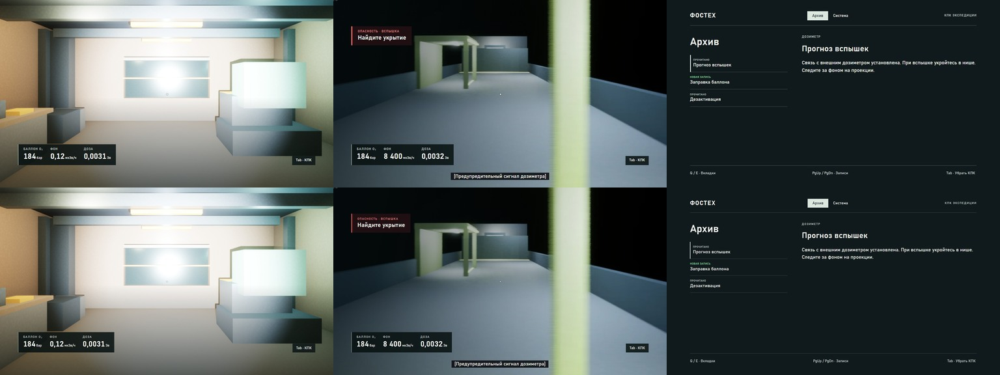

# Сетчатка и поясной КПК

Владелец выбрал два прибора. Проекция на сетчатку сообщает о состоянии скафандра во время движения. Поясной КПК открывает архив на весь экран. Информативность Dead Space и проекция Deus Ex служат ориентирами. Графика, тексты и компоновка принадлежат ФосТех. [Заполненная анкета](InterfaceQuestions.md)

[Спокойный ход](MenuPrototypes/pda.html?scene=calm) · [Радиационная вспышка](MenuPrototypes/pda.html?scene=flare) · [Архив](MenuPrototypes/pda.html?scene=archive). Для интерактивного просмотра откройте локальный HTML в браузере. На листе сравнения сверху 1280 × 720, снизу 1920 × 1080. Цифры в эскизах иллюстрируют набор показаний. Они не задают настройки баллона или радиации.

| Ситуация | Что видит или слышит игрок | Управление |
|---|---|---|
| Спокойный ход | Внизу слева видны давление кислорода в барах, фон в мкЗв/ч и накопленная доза в Зв. Прицел остаётся свободным. У куба под прицелом появляется его масса. Сумму игрок считает самостоятельно. | На объект достаточно посмотреть. |
| Вспышка и укрытие | Красный сигнал «Найдите укрытие», предупреждающий звук и субтитр внизу по центру. Под крышей фон падает, накопленная доза перестаёт расти. Белый означает штатное состояние, зелёный — предупреждение, красный — опасность. Уровень различается также по тексту. | Уйти под укрытие можно с убранным КПК. |
| Новая запись | Устройство однократно мигает и подаёт один звуковой сигнал с субтитром. Спокойный режим заменяет мигание постоянной меткой. Признак «Новая запись» сохраняется до открытия записи. | Tab достаёт КПК с пояса и открывает архив. Повторное нажатие убирает его. |
| Полноэкранный КПК | Слева список с отметками «Новая запись» и «Прочитано», справа заголовок, источник и текст. Вкладка «Система» объединяет сохранение, загрузку, настройки и выход. | Q/E переключают вкладки, PgUp/PgDn — соседнюю запись. Для длинного текста предусмотреть прокрутку. |

Для первого варианта выбраны ширина строки до 60 знаков и две колонки архива. Маркировка и интерфейс русские. Размер текста, контраст, отключение мерцания и полные центрированные субтитры входят в требования к игровому интерфейсу. При переносе показаний потребуется связать шкалу давления с конфигурацией баллона, а поле излучения — со скоростью накопления дозы. Действующий стенд использует проценты. Для согласования баланса физические единицы нельзя получить простой заменой подписи.

**Статус.** В игре реализовано чтение массы под прицелом. Три остальных экрана представлены интерактивным эскизом. Системная вкладка показывает состав команд. Подключение сохранений, реальных показаний, настроек комфорта и физической модели КПК запланировано после просмотра эскизов. Действующий наруч сохраняется в контрольной сборке для сравнения.
