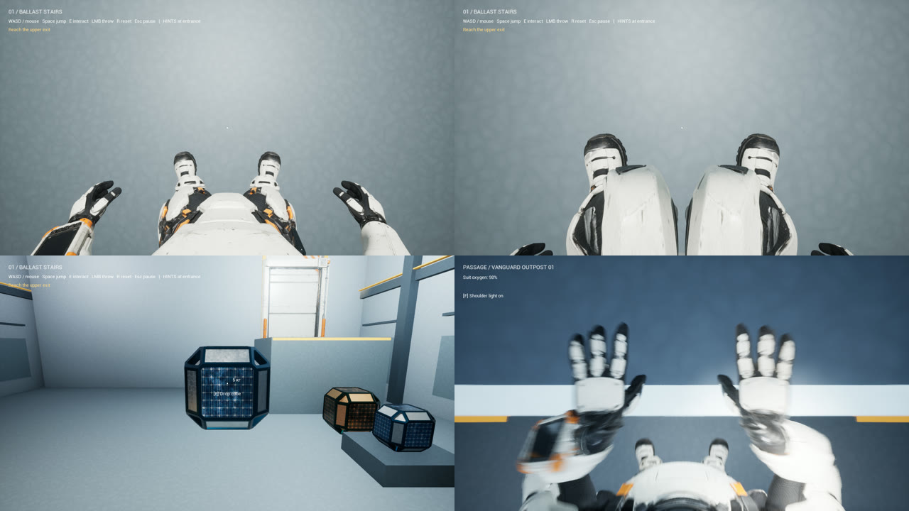

# Примерка Retro Futuristic Soldier и анимаций Fab

25 ноября 2026 г. проверены поставка персонажа, две библиотеки анимаций и четыре игровые позы контрольного EQP-00. Примерка самого Soldier на теле игрока открыта.

## Персонаж и поясной КПК

Для Retro Futuristic Soldier от Red Mallet Studio Launcher предложил только UE 5.8. В поставке 68 файлов `.uasset` и одна карта. Редактор 5.7.4 отказался загружать и `SKM_Soldier_Manny`, и `MM_Idle`. Среди несовместимых версий сериализации у меша — `UE5-Main` 123 при поддерживаемой 121 и `UE5-Release` 68 при поддерживаемой 61. В карточке единственный формат — Unreal Engine. Пакет сохранён локально вне `Content`. Для игровой примерки нужен скелетный меш и текстуры в обменном формате либо пакет для 5.7. [Retro Futuristic Soldier](https://www.fab.com/listings/e31b91f0-da8a-408c-a3fc-2831bd73400c)

Для корпуса поясного КПК владелец выбрал **Rugged Tablet 0.1** от xiaofeiArt. Карточка содержит FBX, OBJ и Blender. Выбор корпуса зафиксирован. Привязка к поясу, положение в руке и открытие голографического архива ещё требуют игровой примерки. [Rugged Tablet 0.1](https://www.fab.com/listings/fc879ff2-dbae-4e44-8920-5212b1b27e09)

## Четыре контрольных кадра EQP-00

Упакованная Win64 Development из цикла #102, UE 5.7.4, Vulkan SM6, RTX 4070 Ti SUPER, 1280 × 720. SHA-256 игрового EXE — `6f4020a00557980efb739b77bc70ff2038d070611c32482a7f30c2511158e480`. Верхний ряд снят на точке старта Stairs при наклоне камеры −89°. В нижнем ряду показаны перенос малого куба в Stairs и уступ в переходе Vanguard.



| Поза | Что видно и что проверено |
|---|---|
| Стоя | Нижнюю часть кадра занимают торс, ноги и ботинки. Пол открыт перед носками. Камера смотрит поверх воротника. |
| В приседе | Игра подтвердила `bIsCrouched=True`. На переднем плане колени, за ними видны оба ботинка. Торс почти выходит из кадра. |
| Куб 5 кг | Куб взят обычным действием E, физический захват подтвердил `GrabbedComponent=Body`. На кадре руки до граней не доходят. Центр тела удерживается на расстоянии до 165 см от камеры. Для видимого хвата нужны достижимые точки контакта и согласование с существующим положением куба при укладке и броске. |
| Уступ | Обе кисти зацепились за кромку. В интервале контакта тест измерил отклонение проксимальных суставов средних пальцев от целевых точек до 0,00 см при точности записи 0,01 см. Дистальные суставы указательного и среднего пальцев прошли допуск 0,2–3 см над поверхностью. Персонаж завершил подъём и встал наверху. |

Штатные сценарии `Training`, `VanguardRoute` и `WristTerminal` прошли в упакованной игре. В отдельном запуске Stairs для съёмки после выхода Vulkan дважды записал `Found 1 unfreed allocations!`. Этот запуск использован для визуального сравнения. [Проверка захвата уступа](../Source/Abandoned/Private/Verification/VanguardMantleVerification.cpp) · [Положение удерживаемого куба](../Source/Abandoned/Private/Player/PuzzleCharacter.h)

Для повторного сравнения откройте `/Engine/Maps/Entry?Chamber=Stairs`. На старте задайте в консоли `set AbandonedTestController ControlRotation (Pitch=-89)`, снимите кадр стоя и затем с зажатым левым Ctrl. Для третьего кадра подойдите к малому кубу у точки (475, 115), поднимите его клавишей E и опустите взгляд на 10°. Для четвёртого кадра запустите `Scripts/Invoke-UeVerification.ps1 -PackageRoot <путь-к-пакету-Windows> -Scenario VanguardRoute -Resolution 1280x720 -Capture`. Изображение в момент контакта называется `Vanguard-Climb-Handhold.png`.

## Что подходит из анимаций

Редактор 5.7.4 вычислил первый кадр всех 60 клипов Attaku на скелете издателя. Для каждой руки измерен угол между направлением от запястья к основанию пальца и направлением средней фаланги. У позы **03** четыре пальца раскрыты, диапазон 5,4–14,3° на обеих руках. Это кандидат для касания уступа перед фиксацией пальцев. Поза **45** даёт умеренный изгиб 33,8–48,2° и подходит для следующей примерки охвата ребра куба. Большой палец и фактическое касание поверхности нужно оценить после переноса на перчатки Soldier. [60 Finger Poses](https://www.fab.com/listings/270419de-d3d7-4a7e-ae95-fc7781fe56ba)

В Free Animation Library проверены все 233 отсчёта четырёх клипов. Расстояние измерено между костями запястий в пространстве исходного скелета. Для удержания кромки наиболее близкая исходная поза — `LedgeClimb_Idle`. При переходе в подъём расстояние между кистями меняется, поэтому фазу отрыва руки предстоит согласовать с игровыми точками контакта. [Free Animation Library](https://www.fab.com/listings/481ef75b-892b-424f-a213-f1cc058c9c19)

| Клип | Отсчётов | Расстояние между запястьями, см |
|---|---:|---:|
| `anim_Crouch_Idle` | 51 | 68,78 |
| `anim_LedgeClimb_Idle` | 61 | 29,66 |
| `anim_LedgeClimb_ClimbUp` | 61 | 29,64–68,72 |
| `anim_Mantle_1M_R` | 60 | 54,12–83,97 |

Чтобы повторить измерения, добавьте обе библиотеки версии 5.7 из Launcher и выполните из корня проекта. Две таблицы с измерениями сохраняются в `Saved/SoldierFit`. Исходники из личной библиотеки остаются локальными.

```powershell
$ue = 'C:\Program Files\Epic Games\UE_5.7'
& "$ue/Engine/Binaries/Win64/UnrealEditor-Cmd.exe" "$pwd/Abandoned.uproject" -run=pythonscript "-script=$pwd/Scripts/InspectFabSuitAnimations.py" -EnablePlugins=PythonScriptPlugin -unattended -nop4 -nullrhi
```
