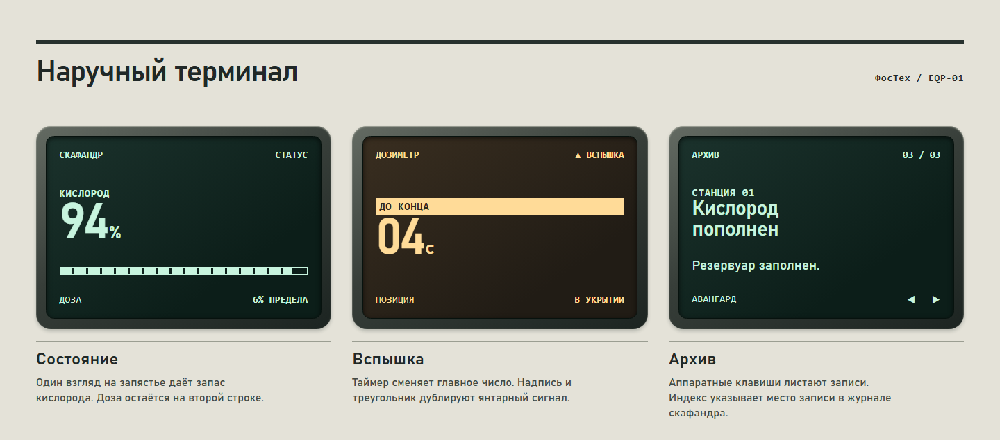

# Скафандр от первого лица и EQP-01

## EQP-00

Тело для первого лица выбрано владельцем. Экспорт Meshy от 22 ноября 2026 г. содержит один узел, один меш, один примитив и один двусторонний материал. В нём 152 982 вершины, 207 919 треугольников, один UV-канал, карты цвета, нормалей и metal/roughness по 4096 × 4096. В GLB нет скелета, весов и анимаций. Габариты по осям glTF — 1,223 × 1,903 × 0,473 м. [Задача и SHA-256](../AssetInventory.csv)

Открытая горловина подходит для размещения камеры. Наручи, тёмные сочленения и светлые пластины читаются с силуэта. На анатомически левом предплечье видны стекло и ряд клавиш. В файле экран и корпус входят в общую сетку. Верх горловины, внутренняя поверхность плеча и запястье требуют проверки именно из камеры при FOV 90°. Число треугольников само по себе не даёт стоимости кадра.

Владелец согласовал для следующего этапа отдельную копию со скелетом и весами тела, пальцев и ног. Корпусу терминала назначается жёсткий вес предплечья. Цель — поднять запястье к взгляду и поставить ладони на уступ без растяжения корпуса. Исходный GLB сохранён локально. Ретопология, разрез корпуса и уменьшение текстур потребуют отдельного решения.

## Исходный художественный бриф

[EQP-01 без ремешка в текущем пакете Vulkan](installed-vulkan.png).

Для персонажа, который поднимает левую руку, опирается на уступ и видит собственные ноги, предлагается **одно тело на одном скелете и отдельный жёсткий терминал на левом предплечье**. Левый рукав, кисть и локоть сохраняют длину и стык во всех позах. Экран, физические кнопки и корпус можно менять независимо от анимации. Цена решения — скиннинг пальцев и плеч, анимации ходьбы и приседа, IK обеих рук и проверка камеры у стен. Для одного только чтения архива текущей руки достаточно.

## Промт для Meshy

Готовый промт для поля **Text to 3D → Preview**, 759 знаков. Для варианта Image to 3D используйте согласованные ракурсы всего тела. EQP-01 и EQP-05 служат референсами корпуса и перчатки при подготовке этих ракурсов. [Формат Meshy Text to 3D](https://docs.meshy.ai/en/api/text-to-3d)

```text
First-person game body of a 50-year-old male expedition engineer. Torso, pelvis, both arms and hands, legs and boots. Closed neck seal, head omitted. Realistic proportions, neutral A-pose, fingers spread, feet apart. FosTech pressure suit: ivory armor, graphite fabric, orange service tabs, reinforced knees, boots with worn treads. Gloves have ivory finger plates and dark rubber palms. Only the wearer's LEFT forearm carries a rigid terminal above the glove: low ivory rectangular case, recessed flat blank glass, vertical row of keys. Four captive screws mount it directly to sleeve armor. No strap. Plain right cuff. Separate rigid screen and casing. Clear elbow and wrist joints. Reserve chest patch for FosTech decal. No weapons, text, numbers or stand.
```

**Приёмка в DCC и Unreal.** Для выбранной EQP-00 сначала примерьте мировой дисплей к встроенному прибору. Отдельная посадка существующего корпуса EQP-01 остаётся запасным вариантом для согласования. Сверьте позу и масштаб по капсуле стоя высотой 180 см и камере на высоте 165 см от пола. Это игровые ориентиры. У старого прибора стекло и кнопки должны по-прежнему помещаться в кадр при FOV 90°. Проверьте левую сторону на виде от первого лица, UV стекла, сгиб локтя, поворот предплечья, ходьбу, присед, хват обеими руками и поднятие терминала у стены. Назначьте сокет дисплея на кости левого предплечья. Корпус должен оставаться жёстким при сгибе кисти. Скелет, корректные веса, LOD и приёмка требуют отдельной работы после генерации. [Игровые размеры](../../Source/Abandoned/Private/Player/MovementProfile.h)

## Что видит игрок



Это эскизы с примерными показаниями. На **статусе** главное число — запас кислорода. В действующую вспышку основное поле той же страницы может показывать время до её конца и положение относительно укрытия. **Архив** сохраняет выбор игрока при тревоге. На существующей странице **связи** достаточно источника и состояния канала: внешний дозиметр, локальная станция или отсутствие связи. На станции прогнозу соответствует «Внешний канал отключён». Пустой архив показывает «Записей пока нет». Ни одно из этих состояний не требует приостанавливать движение. [Лист экранов в HTML](screens.html) · [Состояния игрового терминала](../../Source/Abandoned/Private/Application/Expedition/SuitTerminal.h)

У Pip-Boy из Fallout полезен принцип физических органов управления и листания записей на одном носимом приборе. Для ФосТех масштаб задачи меньше: на ходу читается одна величина, у станции игрок может задержаться на записи. На корпусе остаются потёртости и сервисная маркировка, внутри рабочей области — место для цифр. [Референс Bethesda с фотографиями и видео](https://fallout.bethesda.net/en-EU/news/fallout-pip-boy-3000-replica)

Часы Артёма в Metro: Last Light снаружи показывают оставшееся время фильтра. Для вспышки ФосТех подходит та же постановка вопроса: игроку в укрытии важно сразу увидеть, сколько ещё ждать. Эту роль на эскизе выполняют крупные секунды и постоянная подпись «До конца». [Руководство Deep Silver, раздел Watch](https://content.deepsilver.com/kochmedia/websites/metrolastlight/manuals/metroll_pc_manual_international.pdf)

## План реализации

Главный ориентир — обращение с приборами в *The Invincible*. Для считывания обстановки Ясна берёт в руки дальномер или трекер. У инженера ФосТех похожий жест отвечает на конкретные вопросы: «хватит ли воздуха до стойки?» и «когда можно выйти из укрытия?». На ходу нужен ответ одним взглядом. Работа с архивом допустима во время остановки. [Описание Starward Industries и 11 bit studios](https://store.steampowered.com/app/731040/The_Invincible/)

| Этап | Действие игрока | Условие готовности |
| --- | --- | --- |
| 1. Дисплей действующего EQP-01 | Поднять левую руку, прочитать запас кислорода, дождаться окончания вспышки, перелистать архив | Показания находятся на стекле в игровом мире. Смена страницы, возврат к точке, связь со станцией и запись пополнения проходят в пакете Vulkan. |
| 2. Согласованная копия EQP-00 | Взглянуть на ноги, поднять руку при ходьбе и приседе, ухватиться за уступ | Проверить пальцы, жёсткость терминала, край горловины и пересечения у стен из камеры 165 см при FOV 90°. Сохранить исходный масштаб до примерки к капсуле. |
| 3. Органы управления и сигналы | Переключить страницу рукой в перчатке, заметить начало вспышки с опущенным запястьем | Ход клавиши и короткий тактильный по характеру щелчок подтверждают действие. Тревогу можно распознать при отключённом звуке и без различения цвета. Переключение сохраняет движение и выбор записи. |
| 4. Приёмка читаемости | На ходу определить время до конца вспышки и найти последнюю запись у стойки | Проверить 720p/1080p, тёмный пролёт и свет станции, штатный FOV и крайние поддерживаемые значения. Измерить CPU/GPU и память при поднятии и опускании. Снимать дублирующие подсказки HUD только после проверки критических сигналов. |

### Первый этап в Unreal

Компонент `UWidgetComponent` закреплён на корпусе EQP‑01 и использует тот же режим отрисовки от первого лица. Подложка непрозрачная, виджет Slate рисует три страницы на поверхности 512 × 336. Ввод остаётся у персонажа. В режиме статуса крупная строка показывает кислород. Во время вспышки она переключается на секунды до конца, а подпись сообщает положение игрока относительно укрытия. Источник данных — существующая телеметрия скафандра. Текст запрашивает перерисовку при изменении видимых показаний. С опущенной рукой поверхность скрыта. Сигналы опасности остаются доступными на визоре. [Реализация](../../Source/Abandoned/Private/Expedition/VanguardSuitTerminal.cpp) · [Компонент виджета UE 5.7](https://dev.epicgames.com/documentation/en-us/unreal-engine/widget-components-in-unreal-engine?application_version=5.7)

Корпус и ткань используют исходные PBR-материалы. Чёрная подложка дисплея сохраняет контраст в темноте с автоэкспозицией. Проверять силу свечения и шлейф букв при движении следует по кадру Vulkan. [Кадр из пакета](diegetic-status.png)
